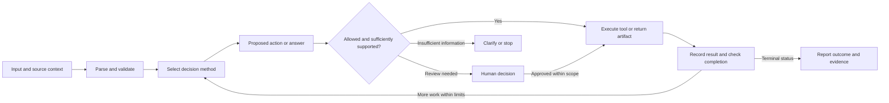

# Agent engineering foundations: source analysis

**Source/edition:** Imran Ahmad, *30 Agents Every AI Engineer Must Build*, Packt, first published March 2026, ISBN 978-1-80610-901-2 (copyright/edition page, physical PDF p.3).

**Scope:** Chapters 1-4, with cross-references only where needed to resolve the pattern inventory. This document extracts architectural ideas for a future independently implemented demo collection. Technologies describe the book's examples and writing-era comparisons; they are not current product recommendations.

**Page-locator convention:** `Ch.N, subsection, printed pp.X-Y; PDF pp.A-B` means the printed page numbers verified against the extracted page header/footer and the 1-based physical PDF pages. Front matter uses its printed Roman numerals where visible. A PDF label alone is not treated as a printed number without corroborating page text. Figures were visually checked where an erratum affects interpretation.

**Source analysis; no implementation or runtime validation performed.** Source code, setup commands, sample outputs, deployment claims, and metrics were read as source material. None was executed or independently reproduced.

## 1. What the book means by an agent

**Source facts.** The operational definition centers on an environment, perceived information, internal processing, actions, and goals. Chapter 1 broadly emphasizes autonomy, persistence, reactivity, proactiveness, adaptability, and goal orientation. Its later taxonomy explicitly includes reactive agents that have no memory, no planning, and no learning. Consequently, the opening trait list is a capability spectrum, not a checklist that every example satisfies. (Ch.1, Introducing agents, printed pp.2-3; PDF pp.33-34; Reactive agents: The reflexive response, printed pp.10-11; PDF pp.41-42.)

**Interpretation.** Treat an agent pattern as a particular allocation of decision responsibility. Ask what the system may choose, what it observes, which state it requires, and which actions it can actually execute. A named agent may be a one-shot adapter, a stateful controller, a coordinated workflow, or an entire team. The title alone does not establish autonomous planning, model training, or persistent memory.

**Proposed demo decision.** Each future demo should identify its smallest necessary agentic decision and compare it with a straightforward deterministic baseline. Do not add learning, a vector database, a planner, or multiple agents merely to make a demo appear more advanced.

## 2. The cognitive loop and component boundaries

**Source facts.** The cognitive loop has five conceptual stages:

| Stage | Source responsibility | Observable artifact worth documenting |
| --- | --- | --- |
| Perception | Convert user input, APIs, sensors, or external signals into usable information | Parsed input with source and timestamp |
| Reasoning | Interpret intent, relevance, priority, or implications | Decision, selected method, or concise justification |
| Planning | Decompose a goal and order actions under constraints | Steps and dependencies, when planning is needed |
| Action | Invoke tools, APIs, databases, services, or peer agents | Validated call and execution result |
| Learning/feedback | Inspect outcomes and update memory or behavior | Outcome record or proposed change |

The final column is an analysis suggestion, not a book-prescribed schema. The book describes these stages as a feedback system rather than a mandatory linear pipeline. (Ch.1, The cognitive loop, printed pp.5-7; PDF pp.36-38.)

**Source facts.** Around a cognition core, the book separates profile/persona, action interfaces, planning/feedback, knowledge/memory, and reasoning/evaluation. Tool results flow back into the loop; evaluators may redirect an action; memory may inform a plan. It identifies the central coordinator as a potential failure point and discusses monitoring, recovery, and alternatives to a monolithic coordinator. (Ch.1, Communication patterns between components, printed pp.8-10; PDF pp.39-41.)

**Interpretation.** This is a vocabulary for separation of concerns. The components can be ordinary functions in one process; conceptual modularity does not imply five services, five models, or five agents. Feedback can mean recording a failure and retrying a plan, not modifying model weights. A natural-language justification is not proof that an action was permitted or that a conclusion was correct.

**Proposed demo decision.** Record the decision inputs, selected action, tool result, evidence, and final status. Show these as a short execution trace and an original flow diagram. Use explicit modules only where they clarify a boundary. Keep authorization and validation in executable control logic rather than relying on the persona to enforce them.

## 3. Reactive, deliberative, and hybrid architectures

| Architecture | Source mechanism | Appropriate problem shape | Main source tradeoff |
| --- | --- | --- | --- |
| Reactive | Direct condition-to-action mapping from current input; memoryless in this taxonomy | Stable triggers, fast decisions, emergency rules | Fast and predictable; cannot reason beyond its rules |
| Deliberative | Sense-Model-Plan-Act with an internal model and future-oriented planning | Dependent steps, incomplete context, changing constraints | Better foresight; extra latency and failure if the world model is wrong |
| Hybrid | Reactive and deliberative layers with priority routing and feedback between them | Immediate responses plus slower strategic adjustment | Flexible; arbitration, resource contention, and interaction failures add complexity |

(Source: Ch.1, Choosing an agent brain: patterns of perception-to-action and its three subsections, printed pp.10-15; PDF pp.41-46.)

**Interpretation.** A hybrid controller is distinct from a system that routes requests between different LLMs. The former divides control by urgency and reasoning horizon; the latter divides model work by task/cost. The book describes model routing separately in Chapter 2. (Ch.2, Hybrid model architecture, printed pp.48-49; PDF pp.79-80.)

**Proposed demo decision.** Choose the simplest architecture that exhibits the target pattern. Where immediate safety matters, an independently testable deterministic guard should bound any slower model-generated plan. This is a design proposal, not evidence that the book's physical-system examples meet real-time safety requirements.

## 4. Two classification systems that should stay separate

**Source facts.** Chapter 1 describes five interaction paradigms: direct LLM interaction, proxy agent, assistant system, autonomous agent, and multi-agent system. Direct LLM calls are one-shot and stateless; a proxy transforms natural input into a structured backend request; an assistant adds tools and session context under user guidance; an autonomous agent manages a goal through an extended workflow; a multi-agent system distributes responsibility across specialists. (Ch.1, The evolution of agent interaction paradigms and Table 1.1, printed pp.22-31; PDF pp.53-62.)

It separately presents five capability levels: Level 0 manual operations, Level 1 reactive automation, Level 2 tool use, Level 3 planning, and Level 4 learning. The axes are autonomy, reasoning, and adaptability. These are the author's organizing framework, not a validated universal maturity standard. (Ch.1, The Agentic AI Progression Framework, printed pp.32-34; PDF pp.63-65.)

**Interpretation.** Interaction shape and capability level answer different questions. A team of agents does not automatically learn; a conversational assistant does not automatically persist personal data across sessions. Level numbers from one table must not be copied into the other.

**Proposed demo decision.** Describe interaction mode and supported capabilities in plain terms. Avoid assigning a maturity score or implying that higher complexity produces a better product.

## 5. State, memory, knowledge, and learning

**Source facts.** The book distinguishes working/session context, episodic histories, and semantic knowledge. Its retrieval pipeline chunks source documents, computes embeddings, stores them with metadata, retrieves relevant passages, and adds that evidence to the model input. Chunk size, metadata filters, reranking, recency, and retrieval observability affect quality. It also discusses buffer versus summarized conversation context. (Ch.1, Knowledge/Memory communication layer, printed p.9; PDF p.40; Ch.2, LangChain, printed p.41; PDF p.72; Supporting infrastructure and retrieval subsections, printed pp.49-53; PDF pp.80-84.)

Few-shot examples change the inference context without changing weights. RAG makes external knowledge accessible without retraining. Neither mechanism by itself demonstrates durable learning. (Ch.3, Teaching by example, printed pp.77-80; PDF pp.108-111; Ch.2, Building the brain of your AI agent, printed p.51; PDF p.82.)

**Interpretation.** Separate four stores conceptually: run state, conversation history, source knowledge, and proposed adaptations. A vector similarity index is a retrieval mechanism, not a substitute for authoritative task state or permission records. Summaries can omit constraints; retrieval can miss or return stale evidence; retained histories can expose data across users.

**Proposed demo decision.** Declare which store exists, who owns its records, what may be written, and what survives a restart. Begin with run-scoped state unless the target pattern requires persistence. When memory is intrinsic to the pattern, document scope, retention, deletion, provenance, and read/write rules. Never describe an unimplemented placeholder memory layer as persistent learning.

## 6. Tools, orchestration, and interoperable contracts

**Source facts.** Tool integration exposes a function together with a name, purpose, and typed input contract. The model selects or proposes a call; an execution layer performs the operation and returns results. Chapter 2 demonstrates a Python Tool wrapper and JSON-schema function calling. (Ch.2, Tool integration frameworks, printed pp.53-55; PDF pp.84-86.)

The book distinguishes tool/service interoperability (MCP) from communication between agents (A2A). It stresses capability descriptions, discovery, invocation, message schemas, versions, state exchange, roles, and status. These are writing-era conceptual descriptions; generic structured JSON messages are not proof of conformance to a current MCP or A2A specification. (Ch.1, Interoperability protocols, printed pp.15-19; PDF pp.46-50.)

**Proposed demo decision.** Define a minimal input/output contract for each tool and agent. Validate parameters, identity, allowed operation, and result before changing state. Classify operations by consequences; require a deliberate human decision where the demo grants authority over an external change. A tool that returns canned data should be labeled a fixture; a generic message adapter should be labeled a local contract.

For future documentation, this original analysis flow captures the control questions without prescribing a universal runtime:

The graph is a proposed documentation aid. Some patterns need no action, human checkpoint, or repeated loop.

## 7. Stopping conditions and human control

**Source facts.** The toolkit's LangGraph example bounds a research loop with an iteration counter. The book discusses explicit stop conditions in AutoGen, human approval nodes, cost ceilings, timeouts, bounded retries, graceful degradation, and risk-based escalation. Assistant systems normally ask before consequential bookings or transactions. (Ch.2, LangGraph, printed pp.42-43; PDF pp.73-74; AutoGen, printed p.46; PDF p.77; Ch.1, Assistant system, printed p.27; PDF p.58; Ch.4, Cost optimization and High-throughput performance, printed pp.99-104; PDF pp.130-135; Accountability and oversight, printed p.111; PDF p.142.)

**Interpretation.** A model saying it is done is one completion signal. Completion should also depend on the task contract, validated results, and a bounded run. Retries are appropriate for transient failures but may repeat side effects. Waiting for a human is a distinct state from success or failure.

**Proposed demo decision.** Specify the success predicate, maximum steps/calls, time and cost ceilings, cancellation behavior, missing-information path, and escalation conditions before implementation. Useful terminal statuses are completed, failed, cancelled, limit reached, and awaiting human input. For side-effecting tools, define replay/idempotency behavior. These state names and controls are proposals; no shared runtime is being chosen here.

## 8. Development lifecycle and evaluation

**Source facts.** The Agent Development Lifecycle proceeds through requirements, architecture/design, implementation/integration, evaluation/optimization, and governance/lifecycle management. It recommends success metrics and constraints before architecture, decision records for tradeoffs, simulation and controlled deployment for integration, and observability/versioning/rollback after release. (Ch.1, The Agent Development Lifecycle, printed pp.19-22; PDF pp.50-53.)

Prompt evaluation compares variants on the same input set, keeps regression cases, isolates a failing PTCF component, and stores versions plus results. The book distinguishes task completion, decision quality, format compliance, latency, fallback frequency, and user feedback rather than treating fluent prose as success. (Ch.3, Iterating and evaluating prompts, printed pp.90-91; PDF pp.121-122; Ch.1, Evaluation and optimization, printed pp.21-22; PDF pp.52-53.)

**Proposed demo decision.** Each pattern should have a compact acceptance table: a normal case, a malformed/unsupported input, an expected dependency failure, and its distinctive architecture behavior. Add memory isolation, authorization, consensus, or simulated control invariants only where the pattern requires them. Keep fixture verification, model-backed tests, provider connectivity, and deployment checks as separate evidence levels. A mocked result establishes control flow, not model quality or real-world reliability.

## 9. Prompt design and its limits

**Source facts.** PTCF structures prompts around persona, task, context, and format. System/user separation gives stable behavior rules and changing task inputs; role authority and boundaries should remain clear at handoffs. The book discusses task decomposition, few-shot examples, linear CoT-style prompts, and exploratory ToT-style prompts, matching sophistication to the actual task. (Ch.3, The two-layer prompt architecture and The PTCF blueprint, printed pp.64-72; PDF pp.95-103; Designing thinking agents, printed pp.73-77; PDF pp.104-108; Making reasoning visible, printed pp.81-85; PDF pp.112-116; Architecting collaboration, printed pp.86-89; PDF pp.117-120.)

**Interpretation.** A prompt can communicate intent and preferred behavior but cannot independently authenticate an agent, enforce an ACL, verify a citation, or guarantee legal compliance. Few-shot examples should demonstrate boundary and failure cases as well as happy paths. Human-readable explanations should cite observable evidence and decisions; requesting a verbose reasoning transcript is not a reliable verification control.

**Proposed demo decision.** Write concise prompts with purpose, authorized scope, supplied context, output contract, uncertainty behavior, and completion conditions. Keep rationale summaries and actual tool traces distinct. Version prompt changes with the same discipline as code, without placing sensitive source data in public examples.

## 10. Build versus integrate and book-era technologies

**Source facts.** The book favors composition and selective replacement over building a monolith. It explicitly says straightforward Python can be better for foundational understanding or highly custom behavior before adopting framework abstractions. Its principal examples use LangChain/LangGraph, but it discusses LlamaIndex for retrieval, CrewAI/AutoGen for coordination, and AutoGPT for autonomous prototypes. It acknowledges abstraction overhead, debugging difficulty, and fragile autonomous control. (Ch.2, Comprehensive analysis of key frameworks through Build-versus-integrate decisions, printed pp.39-47; PDF pp.70-78.)

Model selection considers task fit, latency, context size, hosting, cost/rate limits, and license. Cloud sections compare managed AWS, Azure, and Google services with open-source frameworks and container/serverless options. Memory/search examples name Chroma, FAISS, Pinecone, Weaviate, Milvus, and Qdrant. (Ch.2, Model selection and integration, printed pp.47-49; PDF pp.78-80; The vector database landscape, printed pp.50-51; PDF pp.81-82; Cloud-native agent development platforms, printed pp.55-60; PDF pp.86-91.)

**Proposed demo decision.** Preserve the pattern's architecture while selecting implementation tools later through current official documentation. Prefer a simple independent implementation first when the educational goal is understanding the loop. Integrate mature connectors or libraries when rebuilding them would hide the pattern behind irrelevant engineering. Do not impose one framework, vector store, cloud, or model across all patterns. Provider names, package versions, cloud availability, and sample APIs in this book require fresh verification before implementation.

## 11. Operational, cost, security, and responsibility boundaries

**Source facts.** Chapter 4 ties deployment choices to actual workload/state/control needs. It identifies model tokens, inference time, external calls, memory/storage, and inter-agent messaging as cost sources. Its controls include routing, prompt/context management, TTL caches, cost attribution, budgets, circuit breakers, isolation, timeouts, retries, and fallback paths. (Ch.4, Scaling agent systems and Performance optimization, printed pp.94-104; PDF pp.125-135.)

Rollback must account for models, containers, tool versions, memory, and conversation history. Async systems need versioned event schemas, transient/permanent error distinctions, and failed-event handling. (Ch.4, Operational procedures and Asynchronous messaging, printed pp.105-106; PDF pp.136-137.)

The threat taxonomy spans direct/indirect prompt injection, unauthorized tools, identity spoofing, compromised tools, sensitive-context leakage, and poisoned memory. It calls for per-invocation authorization, least privilege, scoped memory, input/output contracts, tool gating, sandboxing, monitoring, and incident runbooks. Responsibility adds uncertainty communication, human oversight, fairness, auditability, and jurisdiction-dependent governance. (Ch.4, Security and privacy considerations, printed pp.106-109; PDF pp.137-140; Ethical agent development, printed pp.109-113; PDF pp.140-144.)

**Proposed demo decision.** Make examples safe and reviewable with fixtures, synthetic data, read-only defaults, minimal capabilities, and visible failure paths. Define retention and redaction before retaining traces. Measure cost per completed task, including retries and failed attempts; do not derive a cost claim from model price alone. A local container, static scan, or prompt instruction is not sufficient evidence of secure production operation. Legal references in the book are historical source statements, not advice for a Malaysian deployment.

## 12. Source caveats to carry into later work

1. **Scope/count mismatch.** The PDF develops 30 named sections, but they are not the same set as the official numbered 30. Official #18 Recommendation is described in the Preface and foreshadowed on printed p.283 / PDF p.314 but has no developed Chapter 10 section; Domain-Transforming Integration is developed in Chapter 16 and is absent from the repository's numbered list. Chapter 9 calls the second pattern Compliance-Driven, whereas the Preface/repository use security terminology. See `agent-inventory.md` for reconciled locators. (Preface, printed p.xxiii; PDF p.24; Ch.9, Compliance-Driven agents, printed pp.255-265; PDF pp.286-296; Ch.10, printed pp.281-306; PDF pp.312-337; Ch.16, printed pp.473-479; PDF pp.504-510.)
2. **Graph terminology.** Chapter 2 describes LangGraph as both cyclical and a DAG. Its example includes a return edge for further research. Document actual topology; a graph with a cycle is not a DAG. (Ch.2, LangGraph, printed pp.41-44; PDF pp.72-75.)
3. **Exploratory prompt versus search algorithm.** The ToT narrative describes branching/pruning, but the provided listing sequentially passes market analysis to finance and then marketing before synthesis. That code illustrates role-scoped composition; reading it does not establish a general branching search implementation. (Ch.3, Tree-of-thought, printed pp.83-85; PDF pp.114-116.)
4. **Figure/errata differences.** Figure 1.3 has two Reasoning/Evaluation nodes, visually confirmed on printed p.8 / PDF p.39. The [official repository errata](https://github.com/PacktPublishing/30-Agents-Every-AI-Engineer-Must-Build#errata) acknowledges duplication but cites a different page number. Consult the actual PDF location rather than transferring its page offsets. Do not reproduce the original figure as an authoritative blueprint.
5. **Illustration is not validation.** Chapter 3 explicitly marks case-study outcomes as illustrative. Other chapters state business/production metrics without evidence reproduced by this analysis. Package/model references are mixed-era, and legal/platform assertions may be dated. Keep source claims, simulation results, live provider behavior, and independently validated outcomes separate. (Ch.3, Case studies, printed pp.88-89; PDF pp.119-120; Ch.2, writing-era scope, printed pp.37-38; PDF pp.68-69; Ch.4, Regulatory compliance, printed pp.111-112; PDF pp.142-143.)

**Learning objective.** The transferable skill is explaining why a pattern's decision loop, state, tool boundary, failure behavior, and evaluation method fit its problem. An independently built demo should make those choices visible; resemblance to a book notebook is not the success criterion.
