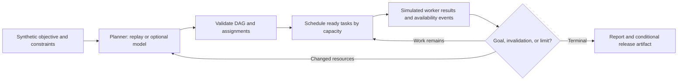

# Planning Agent specification

Slug: 02-planning
Status: demo-ready
Runtime: Python 3.14 (uv CLI)

## Problem and scope

Teach a project owner how a bounded planner decomposes a known goal into a task DAG, schedules parallel work within resource constraints, observes changed availability, and revises pending work without losing completed work. The independently implemented scenario is a synthetic documentation release. Research, writing, review, and packaging workers return simulated evidence; no documents are published or real workers contacted.

## Evidence and decisions

**Source facts:** the retained [planning brief](../../agent-library-analysis/agents/02-planning.md), Imran Ahmad, *30 Agents Every AI Engineer Must Build*, Packt, March 2026, Chapter 5, printed pp.131–135 / physical PDF pp.162–166, describes hierarchical decomposition, dependencies, resources, feedback, and revision. It discusses symbolic and LLM approaches without supplying a standalone runnable planner, task schema, persistence design, or operational stop budget. The [foundations](../../agent-library-analysis/foundations.md) support explicit controller authority and separate evidence modes.

**Selected decisions:** a small, modeled domain with six required tasks; deterministic offline planning as an inspectable baseline; optional OpenAI structured-output planning through the same validator; event-driven simulated execution; in-memory run state; stdout report; no durable learning. This is neither a PDDL/STRIPS solver nor a Tree-of-Thought implementation. The planner chooses task ordering, extra dependency edges, and qualified worker assignments within a host-defined task vocabulary. The scheduler owns actual start/finish times and evidence. Replay is simulation evidence, not AI evidence. Arbitrary-goal interpretation and optimal scheduling are outside scope.

## Inputs and outputs

The CLI accepts `--example` from bundled synthetic scenarios and `--mode replay|live` (default replay). Default example: `normal`. No arbitrary input path or `.env` loading. The reusable controller accepts a strictly validated scenario, enabling focused checks without granting a file/network tool.

Scenario: nonempty bounded objective; worker availability; a simulated deadline of 1–30 ticks; at most two deterministic availability-change events triggered immediately after named tasks complete; optional simulated task failure. Reject unknown keys, IDs, malformed types (including boolean integers), invalid event targets, and out-of-range values before planning. Scenarios are trusted synthetic domain inputs; objective text is untrusted contextual data, never authority.

Required tasks (each exactly once in every plan):

| ID | Workstream | Duration (ticks) | Capability | Required ancestors |
| --- | --- | --- | --- | --- |
| requirements | research | 2 | research | none |
| examples | research | 2 | research | none |
| draft | authoring | 2 | write | requirements, examples |
| technical-review | review | 1 | review | draft |
| editorial-review | review | 1 | review | draft |
| package | release | 1 | package | technical-review, editorial-review |

Workers: `researcher-a`, `researcher-b` (research), `writer` (write), `reviewer-primary`, `reviewer-backup` (review), and `publisher` (package). Each has capacity one. IDs, task kind/workstream, duration, and capability are host facts. A plan supplies six task records `{id, worker, depends_on}` and `status=plan`; or `status=blocked` with an empty task list. Unknown/duplicate/missing tasks, duplicate/unknown/self dependencies, cycles, missing required ancestry, wrong capabilities, and unavailable assignments for pending work are invalid. Arrays and strings have small schema bounds. Completion is never planner-declared.

Report: terminal `completed|blocked|failed|limit_reached|cancelled`; safe reason code; mode; validated plan revisions; fixed-label event trace with task/worker IDs and ticks; per-task status/results; simulated elapsed time; planning/replan counts; and an in-memory release artifact only for `completed`. Never include raw prompts, objective/model prose, credentials, or exception payloads. Exit 0 for completed; 2 for blocked/failed/limit; 130 for cancellation. Argument parse errors use argparse exit 2.

## Architecture and state

`contracts` owns strict data shapes and domain constants; `backends` proposes plans; `validation` enforces graph/revision/resource rules; `controller` owns event-driven execution, observations, revisions, and termination; `fixtures` packages synthetic scenarios; `cli` selects a scenario/mode and serializes the report. Equivalent small local module boundaries are allowed.

Everything is run-scoped and recreated for every invocation. Trace and plan history are observable state, not cross-run memory. No dependency on another case or service.

## Tools and authority

The sole execution capability is a host simulator for the six allowlisted task IDs. It starts only dependency-ready work on an available qualified idle worker; at most two tasks run concurrently and one per worker. Results are host-generated bounded evidence IDs tied to that run's successful tasks. Task completion comes from simulated finish events, never model claims. The final release artifact references all six successful task evidences. A failed task produces no successful evidence and never packages the release.

The optional model is a planning proposal source, with no tools and no direct execution capability. The CLI sends only the selected synthetic scenario, domain description, and bounded current state to the official OpenAI endpoint. It reads `OPENAI_API_KEY` from the invoking environment only; no custom base URL, inherited proxy endpoint, shell/file/web/delegation tools, notifications, or publication. Missing key/SDK fails preflight before work. Model configuration is case-local and live compatibility remains unverified until actually exercised.

## Execution and termination

1. Validate all scenario fields and live prerequisites before obtaining any plan or running work.
2. Obtain one initial proposal; validate the entire graph and assignments before any simulated effect. A planner `blocked` response is accepted only if the host can prove some remaining required task has no available capable worker; otherwise fail with `invalid_plan`.
3. Start dependency-ready tasks in stable task-ID order, respecting concurrency and per-worker capacity. Jump simulated time to the next finish event, subject to the scenario deadline. A finish exactly at the deadline is allowed; work requiring a finish after it is not reported completed.
4. Process simultaneous finishes, then availability changes, then select new work. Events apply once. An event can change workers serving pending tasks; completed task results remain valid. If an event removes a worker used by running work, stop that run as blocked with no release; no claim of cancellation/rollback of real effects is made.
5. When pending assignments become unavailable, request a revision before scheduling more work. Preserve completed task records (including assignment and dependencies) exactly and never rerun them. Existing pending graph/worker choices may change only through a newly validated proposal. Revisions are between execution batches; no in-flight task can be rewritten. If any remaining required task has no capable available worker, the controller may stop as blocked directly, recording the resource observation; this demo does not wait for hypothetical future recovery. Otherwise the planner may reassign or add safe dependencies; it cannot remove required prerequisites or claim work succeeded.
6. Stop at 2 replans (3 total planning calls), 12 scheduling batches, 30 simulated ticks, or 90 seconds wall time. Provider request timeout at most 20 seconds, 2500 maximum output tokens, no automatic retries. Provider timeout yields `limit_reached`; other transport/refusal/incomplete/malformed proposals fail safely with a fixed reason and no replay fallback. User interruption yields `cancelled` / exit 130, no release artifact.
7. Complete only when all six required task results succeeded and the package finished within limits. Emit the release artifact then. Dependency/tool failure, invalid plan, deadline, cancellation, or unavailable reviewers must never produce a release artifact. No retry of failed tasks or continuation after terminal failure.

## Acceptance criteria

All selected readiness criteria require fixture or mocked-provider evidence; live model/deployment are optional and separately reported.

1. Normal replay completes six tasks in dependency order, demonstrates overlapping research and review with separate worker capacity, and creates the release artifact only after all prerequisites succeed (fixture).
2. Primary reviewer departure after drafting produces a visible validated revision assigning pending review to the backup, preserves completed work, and completes with serial reviews (fixture).
3. No available reviewers produces a visible blocked state, resource observation, unfinished review/package, and no release artifact (fixture).
4. Cycles, unknown/duplicate tasks/dependencies, missing semantic prerequisites, wrong workers, false blocked claims, unsafe completed-work revision, invalid inputs, and invalid worker outputs are rejected (fixture).
5. Task failure, tight deadline, replan/batch/wall/provider budgets, and cancellation terminate truthfully without false release evidence (fixture or mocked-provider as appropriate).
6. Two runs share no mutable state, imported replay makes no provider request, and an isolated copy of only this case installs and runs without sibling resources (fixture).
7. Optional provider checks assert strict structured schema, official endpoint, `store=false`, no tools/retries, bounded requests, request/revision context, refusal/incomplete/transport handling, sanitized errors, and no silent replay fallback (mocked-provider).

## Dependencies and open decisions

CPython 3.14.8 selected in `.python-version`, with case-local uv manifest/lockfile; Pydantic 2.14.1 for strict schemas, pytest 9.1.1 for checks, Hatchling 1.32.4 for packaging, optional OpenAI Python SDK 3.31.0. Selected versions were found in local package/cache metadata; installation and behavior evidence are recorded separately in README. No agent framework, queue, database, or external scheduler is needed. No material behavior decisions remain open.

Official API documentation checked on 2026-10-18: [Structured Outputs](https://developers.openai.com/api/docs/guides/structured-outputs) and [Python SDK](https://developers.openai.com/api/reference/python). Live planning selects documented [GPT-6 Luna](https://developers.openai.com/api/docs/models/gpt-6-luna), `reasoning.effort=none`; the model ID is an alias, not an immutable dated snapshot. SDK configuration fixes the official endpoint and disables retries, redirects, ambient proxies, custom headers, and debug logging. Request-level cancellation and the host deadline bound provider waiting; transport-operation timeout alone is insufficient. Live account availability/quality, hosted CI, and deployment remain unverified until run.
