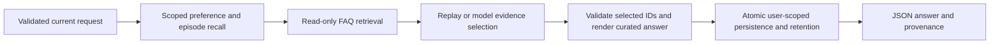

# Memory-Augmented Agent specification

Slug: 03-memory-augmented
Status: demo-ready
Runtime: Python 3.14 (uv CLI)

## Problem and scope

A synthetic study assistant remembers a learner's explicitly chosen explanation style across sessions and answers questions from a small, fixed course FAQ. The learning objective is to make working, episodic, and semantic memory boundaries observable, including provenance, correction, user isolation, expiry, and deletion.

The smallest agentic decision is selecting relevant FAQ evidence from bounded candidates for the current query. Replay provides a deterministic lexical baseline; optional OpenAI mode selects evidence using a model. The host controls preference authority, persistence, citations, and final rendering. This is not an open-domain tutor, vector-search benchmark, trained learner, or authenticated multi-user service.

## Evidence and decisions

**Source facts, from retained analysis:** Imran Ahmad, *30 Agents Every AI Engineer Must Build*, Packt, March 2026, Ch.5, printed pp.135–141 / PDF pp.166–172 distinguishes working context, timestamped episodic history, and semantic knowledge. Its simplified class retrieves up to three user records and then stores an interaction; vector adapters, correction, deletion, retention, failure policy, and consolidation are unspecified. The broader healthcare architecture is not clinical validation. See the [source brief](../../agent-library-analysis/agents/03-memory-augmented.md) and [foundations](../../agent-library-analysis/foundations.md). No original book code is copied or claimed independently reproduced.

**Selected decisions:** use a synthetic study scenario; Python/uv; standard-library SQLite; explicit style updates; a packaged FAQ; transparent lexical retrieval rather than embeddings; bounded history instead of generated summaries; deterministic rendering from curated FAQ content; replay plus an optional structured-output evidence selector. Demonstrating the three conceptual memory roles does not claim to reproduce the book's vector architecture. No material scope decision remains open.

## Inputs and outputs

- `ask`: required `--user`, `--session`, and `--query`; optional explicit `--remember-style` in `concise`, `step-by-step`, `example-first`; `--mode replay` (default) or `live`; `--store` name (default `demo`). IDs/store names are 1–64 ASCII letters, digits, underscore or hyphen, beginning with a letter or digit. Query is nonblank, at most 1,000 characters, and rejects control characters. No arbitrary paths, SQL, executable code, URLs, or tool names are accepted as authority.
- `forget`: `--user` and optional `--store`. Deletes only that user's preference and interaction rows; never invokes a provider. Repeating it succeeds with zero rows deleted. Session IDs and a model cannot request deletion.
- JSON stdout for successful and failed runs, with a terminal status, stable failure code where applicable, mode, selected FAQ evidence, applied style and its source (`current`, `memory`, or `default`), recalled episode provenance, bounded trace, and answer. Provenance includes record ID, source session, and UTC timestamp for remembered preferences and episodes. Default style is `concise`, with an explicit indication that no preference is remembered.
- Answers are rendered from the selected packaged FAQ entries using curated style variants; FAQ IDs and source titles identify factual provenance. For no supported evidence, return `insufficient_knowledge` and an honest unsupported-answer message; never invent a fact or a prior preference. Successful supported turns return `answered`. `forgotten`, `failed`, and `cancelled` are other terminal statuses. CLI exit 0 for answered/forgotten, 2 for insufficient knowledge or ordinary failures, 130 for cancellation.

## Architecture and state

1. **Working memory:** the validated current request, active preference, at most three prior episodes, and at most three FAQ candidates. It lasts for one turn. Current explicit style overrides remembered style.
2. **Episodic memory:** SQLite preference state and interaction metadata, partitioned by the supplied user ID. Preference state contains the last explicit value and provenance. Interaction rows contain the user query, session, UTC time, and selected FAQ IDs/applied style, not generated answer text. They are contextual data, never factual knowledge or instructions.
3. **Semantic memory:** a versioned, packaged synthetic course FAQ with IDs, titles, keywords, and curated answer variants. It is read-only at runtime. Token overlap ranks candidates deterministically; ties use stable FAQ ID ordering. No token match means no evidence and no model call.

Recall considers only unexpired episodes for the exact user; rank by query-token overlap, then newest timestamp and record ID, returning at most three positive-overlap episodes. Preference recall is separate, so lexical similarity cannot hide the active preference. Latest explicit update wins across sessions. No implicit preference extraction from query/model text occurs.

Retention is 30 days: records at or before `now - 30 days` are not eligible for recall. Each successful processed turn (`answered` or `insufficient_knowledge`) atomically persists the interaction, the optional explicit preference update, and retention pruning for that user. Keep at most 20 newest interactions per user; the current preference survives history trimming until its own 30-day expiry. Failed/cancelled turns do not commit changes. No background sweeper or summary generation exists. Expired rows may remain on disk until the next successful turn or `forget` for that user; never describe this as physical expiry erasure.

The CLI uses only `<case>/private-data/<store>.sqlite3`. Validate store names and reject symlinked state directories/database files and existing nonregular or multiply linked database files before SQLite access; keep journal sidecars within the same directory. Tests may inject isolated temporary roots. Single local operator and sequential use are the supported execution model; database lock/corruption/schema mismatch is a terminal storage failure, not a signal to reset or overwrite data. No encryption, identity verification, secure erasure, or production tenancy claim is made. `forget` is logical row deletion, not forensic deletion from filesystem backups or SQLite pages.

## Tools and authority

The host has exactly these capabilities: scoped SQLite reads, append interaction/upsert explicit preference, prune this user's retained records, delete this user's records on explicit `forget`, and read the packaged FAQ. The model has no callable tools, memory-write authority, paths, identity choices, or freeform answer authority. It may return only a bounded list of retrieved FAQ IDs; reject unknown, duplicate, out-of-candidate, or schema-invalid selections. Empty selection is an abstention, not a fabricated answer. A current query or retrieved string cannot alter these capabilities.

Live mode sends the current query, applied style, up to three recalled episodes, and FAQ candidates to OpenAI. Do not send other users' records, the raw database, credentials, or unnecessary user/session identifiers. The README must make this data boundary explicit. `OPENAI_API_KEY` and an explicit `MEMORY_AGENT_MODEL` supporting Responses strict structured output are required from the invoking environment; there is no implicit model default, `.env` auto-loading, or secret logging. Use the official endpoint and disable environment redirects/custom headers/proxies so ambient configuration cannot redirect contextual data. Provider errors are sanitized to stable codes without exception contents.

## Execution and termination

1. Validate all input and state paths before mutations; open/validate schema with a bounded SQLite timeout. First access may initialize an empty schema even when the turn later fails; no failed turn memory is committed.
2. Read only the requested user's eligible preference and episodes; compute the current effective style.
3. Rank the FAQ and bound working context. If no candidates, skip the backend and return insufficient knowledge after a successful atomic memory commit.
4. Replay picks the top candidate. Live performs at most one Responses call, no SDK retries, with a 20-second total deadline and bounded output (at most 512 tokens), strict JSON schema, no tools, `store=false`, and background execution disabled. No live-to-replay fallback.
5. Reject provider refusal, incomplete output, malformed schema, invalid citations, timeout, or other provider failure. Failure exposes no answer and commits no turn memory.
6. Render only validated curated evidence in the effective style; commit state atomically. If persistence fails, do not report an answer as successfully remembered. Emit a sanitized storage failure and roll back the transaction.
7. Emit the terminal JSON and stop. No autonomous loop, automatic retry, recursive retrieval, or unbounded prompt growth. Keyboard interruption rolls back uncommitted work and terminates as cancelled. A committed turn remains durable if the process is killed after commit; CLI output is not a distributed delivery guarantee.

## Acceptance criteria

Criteria describe required behavior; results belong in README.

| Criterion | Evidence mode |
| --- | --- |
| First session explicitly remembers a style; a separate process/session recalls it with the original provenance and answers from the FAQ. | fixture/CLI |
| A different user cannot retrieve that preference or any episode; a new user receives default provenance without invented memory. | fixture |
| Explicit style correction wins immediately and persists; query/model text alone cannot change preferences. | fixture, mocked-provider |
| Recall returns at most three scoped relevant episodes; FAQ context is at most three; retention caps history at 20 and ignores expired records including exact expiry boundary. | fixture |
| Unknown knowledge abstains with no invented citation; invalid and out-of-candidate model IDs fail without committing memory. | fixture, mocked-provider |
| Forget removes only the selected user's logical records, is idempotent, and leaves no preference on the next turn. | fixture/CLI |
| Locked/corrupt/incompatible stores, malformed input, path/symlink escape, and write failure produce sanitized terminal failures without overwriting existing memory. | fixture |
| Provider request uses bounded strict output, official endpoint, no tools/retries/background storage; timeout/refusal/incomplete/malformed output fails without fallback or writes. | mocked-provider |
| Interruptions before commit do not persist the turn; failures do not leak provider errors/credentials. | fixture, mocked-provider |
| Case-only installation and documented run path work without sibling files, credentials, or network in replay mode. | fixture/isolated copy |

## Dependencies and open decisions

The case pins Python 3.14.8 with a local uv lockfile. Replay runtime uses only the standard library. Development/build pins are pytest 9.1.1 and Hatchling 1.32.4; optional provider pins are OpenAI SDK 3.31.0 and httpx2 2.13.1. Their local installation and SDK mock-HTTP request behavior passed verification; see README for exact evidence. Live compatibility/model quality, hosted CI, deployment, encryption, authenticated tenancy, vector retrieval, and summarization remain outside the verified v1 scope.

Official API references checked on 2026-10-19: [Structured Outputs](https://developers.openai.com/api/docs/guides/structured-outputs?api-mode=responses), [Responses create](https://developers.openai.com/api/reference/python/resources/responses/methods/create), [data controls](https://developers.openai.com/api/docs/guides/your-data), and [Python 3.14 SQLite](https://docs.python.org/3.14/library/sqlite3.html). `store=false` is not a zero-retention guarantee, and a client timeout does not establish that server-side work or billing stopped. Official documentation review does not establish live SDK/model compatibility.
