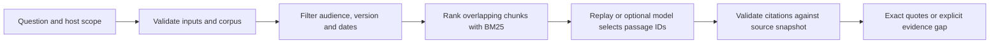

# Knowledge Retrieval Agent

Slug: 04-knowledge-retrieval
Status: demo-ready
Runtime: Python 3.14 (uv CLI)

## Purpose and contract

Retrieve traceable passages from synthetic, versioned support documents. Host-enforced access/version/freshness filters precede lexical ranking; validated evidence selections become exact quotations and citations. Offline replay is deterministic. Optional OpenAI selection stays within the same candidate evidence.

See [SPEC.md](SPEC.md) for the contract and [PLAN.md](PLAN.md) for build checkpoints. This is an extractive learning demo, not enterprise search or production authentication.

## Architecture and flow



All state is request-local. The index is rebuilt from a bounded, packaged JSON corpus on each query; a SHA-256 digest identifies the bytes used. Two adjacent paragraphs form a chunk, with one paragraph of overlap. Retrieval returns at most three positive-score chunks; selection returns at most three unique paragraphs. The host renders the answer from those source slices.

Audience/version/date filters run **before** ranking. Public scope can retrieve public sources; staff scope adds staff sources. Sources must be effective at the requested date and reviewed within 90 days, including the 90th day. End dates are exclusive. The corpus includes original synthetic support material; it is not a real product policy.

Each run performs at most one search and one model request, with no retries or external tools. Empty evidence or conservative replay coverage failure abstains; corrupt input, invalid citations and provider failures terminate without an answer. Querying writes no state.

## Setup and run

Prerequisites: Python 3.14 and uv. Run from this case directory:

```bash
uv sync --locked
uv run --locked knowledge-agent ask "How can I cancel my subscription?" --as-of 2026-10-19
uv run --locked knowledge-agent ask "Can I pay with crypto?" --as-of 2026-10-19
```

The first query is the normal retrieval example; the second exercises absent evidence. JSON includes status, reason, extractive answer, citations, retrieved chunks, scope and execution trace. The reproducible examples pin the date because sources intentionally become stale under the 90-day policy. Without `--as-of`, the CLI uses today's UTC date.

Other host-scope options are `--audience public|staff` and `--version VERSION` (default `2.0`). The audience flag is a local simulation, not an authentication boundary.

### Optional OpenAI selection

```bash
uv sync --locked --extra live
export OPENAI_API_KEY='your-key'
export OPENAI_MODEL='your-supported-model-id'
uv run --locked --extra live knowledge-agent ask "How can I cancel my subscription?" --backend openai --as-of 2026-10-19
```

Use environment variables; `.env.example` documents their names and is not loaded automatically. Never commit a real key. The model must support the Responses API and strict structured output. The caller selects the model; live compatibility is not inferred from mocked-provider tests.

The adapter sends the question and eligible candidate passages to OpenAI. It accepts passage IDs or abstention, never model-written answer prose. It fixes the official endpoint, disables retries/tools/redirects/environment proxies, limits output to 512 tokens, sets a 20-second HTTP timeout, and uses `store=false`. The timeout is not a hard wall-clock deadline; the output cap includes reasoning tokens. `store=false` does not establish Zero Data Retention; see [API evidence](SOURCES.md). A failed live request is not replaced by replay.

The synchronous CLI temporarily suppresses SDK/transport logging and ambient SDK custom-header settings, then restores process settings. It is not a concurrent server adapter. Only the explicitly exported API key/model select provider configuration.

## Verification

Verified on: 2026-10-19
Verification command: `UV_CACHE_DIR=/tmp/agent-atlas-uv-cache uv run --locked --offline --extra live pytest -q`
Verification mode: fixture
Verification result: passed
Verified scope: validated corpus and query bounds, exact source offsets/digests, overlapping chunks, deterministic ranking, pre-ranking access/version/date filtering, replay evidence gaps, invalid selections, source refresh, cancellation and CLI behavior.

The complete suite passed **181 tests**, with no skips or warnings, on macOS arm64 / CPython 3.14.8 / uv 0.12.23. That total includes fixture, CLI and mocked-provider tests; it is not a live-model result. The parent, builder and independent reviewer each ran the suite successfully.

Mocked-provider evidence from the same command: actual OpenAI SDK 3.31.0 with httpx2 2.13.1 MockTransport checked the official endpoint, strict schema, eligible-only payloads, disabled tools/retries/redirects/proxies, timeout/output limits, early preflight, zero calls for empty evidence, refusal/incomplete/malformed responses, invalid citations, 401/429/500/503 responses, timeouts and interruption. No request reached OpenAI.

Re-run the complete fixture/mocked-provider suite:

```bash
UV_CACHE_DIR=/tmp/agent-atlas-uv-cache uv run --locked --offline --extra live pytest -q
```

The `live` extra installs the pinned SDK for transport mocks; this test command does not make live API calls. Offline `uv` commands require previously cached dependencies. Use `uv sync --locked --extra live` first on a new machine.

Additional checks performed on 19 October 2026:

| Check | Result and scope |
| --- | --- |
| 12 independent CLI scenarios through `.venv/bin/knowledge-agent ask ...` | Passed cancellation, absent/partial-match evidence gaps, billing email, support, public/staff access, legacy version, stale sources, invalid date/empty question and missing provider configuration; exact source slices/digests and excluded metadata were checked. |
| Case-only installation with `uv sync --locked --offline --no-dev` | Passed outside the checkout, without credentials, sibling files, `PYTHONPATH` or the OpenAI SDK. |
| Full suite in a fresh case-only copy | The same locked/offline test command passed all 181 tests without credentials or sibling resources. |
| `uv build --offline --no-sources`, followed by `uv pip install --offline --no-deps --python <fresh-venv>/bin/python <wheel>` | Passed. Installed wheel ran the cancellation example from outside the checkout after the copied `src/` was removed; corpus/prompt resources were packaged, and replay required no OpenAI SDK. |
| Independent review | One cleanup-interruption defect was fixed and covered by a regression; final review found no remaining actionable findings. |
| `python3 scripts/check_structure.py` from the repository root | Passed structural/catalogue checks; this is governance evidence, not runtime proof. |
| `git diff --check` | Passed. |

Selected fixture/mocked-provider acceptance criteria are complete. **Unverified:** live model relevance and account compatibility, hosted CI, deployment and production suitability. No live call, push or deployment was performed.

## Limitations and references

Replay requires all informative normalized query terms to appear across selected evidence. It deliberately abstains on many paraphrases. Lexical matching can still return semantically unsuitable evidence; scores, token coverage and exact citations do not prove that a passage answers the question. Optional model selection does not remove that limitation, and no general answer-quality benchmark is claimed.

Freshness is a declared policy over synthetic metadata. The audience flag simulates host identity, not authentication. Source text is untrusted data: it can influence selection but cannot grant tools, change host scope or introduce invented source text. Refresh the bundled corpus by editing/reviewing its versioned metadata and content; there is no ingestion service, persistent index, vector search or durable memory.

Inspired by Imran Ahmad, *30 Agents Every AI Engineer Must Build*, Packt, March 2026, Ch.6, printed pp.146–153 / PDF pp.177–184; see [source brief](../../agent-library-analysis/agents/04-knowledge-retrieval.md) and [verified source/API notes](SOURCES.md). Runtime choices are independent decisions; book code is not copied or treated as validation evidence.
