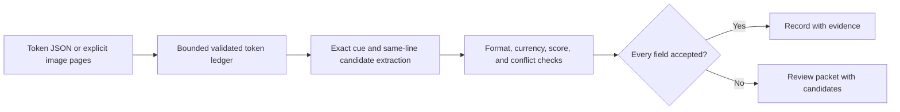

# Document Intelligence Agent specification

Slug: 05-document-intelligence
Status: demo-ready
Runtime: Python 3.14 (uv CLI, macOS/Linux POSIX)

## Problem and scope

Help a developer inspect how English printed invoices become validated records with field-level evidence and review decisions. Extract invoice number, invoice date, and MYR total from synthetic OCR-token documents or optional local OCR of PNG/JPEG pages. The agent makes a bounded, deterministic decision about whether each field has sufficient evidence under this demo's rules.

This case does not use an LLM, learn from corrections, approve payments, or post records. PDF rendering, handwriting, arbitrary layouts, table extraction, fuzzy labels, and a review UI are outside the selected scope. Review output is a packet for a human, not a completed approval workflow.

## Evidence and decisions

The retained [source brief](../../agent-library-analysis/agents/05-document-intelligence.md) attributes the architecture to Imran Ahmad, *30 Agents Every AI Engineer Must Build*, Chapter 6, printed pages 153-160, physical PDF pages 184-191. It describes OCR, layout, extraction, validation, and review. Its sample uses heuristics without LLM orchestration. The brief identifies lost confidence/provenance and first-nonempty cross-page merging in the source example. These are inherited source-analysis findings; the purchased book body was not rechecked in this build.

Selected decisions add explicit provenance, retain uncertain candidates, and refuse conflicting values. The book's illustrative accuracy/review targets are not acceptance criteria or measured results.

Two independent design candidates considered a strict JSON-token boundary and direct TSV fixture ingress. Select JSON tokens because synthetic evidence and validation are easy to inspect independently of an OCR wire format. Keep Tesseract TSV private to the optional adapter. Adopt same-line-only association from the second candidate, avoiding ambiguous next-line guesses. A model-first design adds cost and weaker reproducibility without serving the selected learning objective. A fixture-only design omits the useful OCR boundary, so implement an optional image adapter with separate qualification.

## Inputs and outputs

The CLI exposes packaged examples, an explicitly supplied token JSON file, or one to three explicitly supplied image files. Modes are mutually exclusive. No URLs, directory scanning, archives, arbitrary command arguments, or executable selection are accepted.

The token schema has `schema_version: 1` and contiguous 1-based pages. Each page contains positive integer dimensions and a list of tokens with a page-local unique ID, nonempty text, a block/paragraph/line key, pixel bounding box, and OCR score from 0 to 100 or null. The implementation documents exact key names and a complete example. Reject unknown and duplicate JSON keys, booleans used as numbers, nonfinite values, invalid geometry, duplicate IDs, and excessive input. Bboxes use top-left origin and half-open edges within the original page. Text is data, never an instruction.

Every report includes source mode (`fixture` or `local_ocr`), source SHA-256 fingerprints, a token ledger, the three field results, and a derived document status. OCR mode identifies its engine. Fixture scores are synthetic inputs, never measured OCR quality. Each candidate retains raw value, normalized value or null, separate cue/value token IDs and bounding boxes, page, diagnostic minimum OCR score, and validation/review reasons. A field is either accepted with one normalized value, or review-required with null accepted value and all candidates. The document is `extracted` only when all three fields are accepted; otherwise it is `review_required`.

An extracted document includes a complete record. A reviewed document has no complete record. Accepted fields remain inspectable individually. Money is parsed with Decimal and serialized as a two-decimal string. Error output contains a stable code, no raw exception or invoice text, and no partial accepted record.

## Architecture and state

Use immutable typed records for pages, tokens, evidence, candidates, and accepted/review field results. Keep validation at ingress and field policy in one domain module. There is no persistent memory. All state belongs to one invocation.

The public call is `extract_invoice(source) -> InvoiceReport`, where source is a token file, packaged example, or explicitly ordered image pages. The boundary owns input validation and optional OCR; callers do not coordinate pipeline stages. Internal pure extraction receives a validated document. A CLI adapter renders JSON and exit codes.

`invoice.py` owns domain types and field policy, `source.py` owns source selection and validated token ingress, `ocr.py` owns image and native-process handling, and `cli.py` owns the command interface. Fixtures are packaged so installed-wheel examples work without source-tree files.

## Extraction and review rules

- Match complete normalized labels at the start of a line. Invoice number labels are `Invoice No`, `Invoice Number`, and `Invoice #`. Date label is `Invoice Date`. Total labels are `Grand Total`, `Total Due`, and `Amount Due`. Case and trailing colon/period punctuation can be normalized. `Subtotal`, `Due Date`, and arbitrary substrings do not match.
- Group by page and block/paragraph/line key, then sort by horizontal position. Only take the nonoverlapping value span to the right of its cue on that line. No cross-column or next-line fallback. Multiple target cues or ambiguous geometric overlap produce review, never a first-match choice.
- Adjacent cue/value tokens must share vertical pixels and their horizontal gap must be at most six times their maximum token height. This narrow spatial rule applies within the cue and value spans as well as across their boundary. Distant columns or disjoint vertical ranges sharing one OCR line key retain candidates with `ambiguous_layout` review. This is not general column detection.
- Accept invoice identifiers matching `[A-Z0-9][A-Z0-9/-]{1,31}` without OCR substitutions. Accept only real calendar dates formatted `YYYY-MM-DD`. Other date formats produce review.
- Accept an explicit `RM` or `MYR` marker followed by a positive amount with exactly two decimals. Optional thousands commas must have correct grouping. Maximum amount is `999999999.99`. Reject missing/other currency, malformed grouping, signs, trailing text, and multiple amounts through review.
- Retain every cue-linked candidate across all pages, including invalid and low-score candidates. Identical normalized values retain all evidence. Any different valid value, invalid relevant candidate, missing score, or score below 80 requires review for that field.
- A candidate's score is the minimum raw OCR score across its label and value tokens. It is a routing diagnostic, not a calibrated probability of correctness. A missing field has a missing reason and an empty candidate list. Review reasons are stable codes.

## Tools and authority

Token mode is offline and invokes no OCR or provider. Image mode uses Pillow to validate PNG/JPEG data and a fixed Tesseract argument vector with English data and TSV output. Use `shell=False`; never execute document text. Preserve the original pixel coordinate system by rejecting nontrivial EXIF orientation and multiframe input. Do not preprocess, rotate, crop, or rescale silently.

Read only explicitly supplied regular files, rejecting symlink leaf files and special files. JSON output goes to stdout. The adapter uses bounded in-memory pipes with no lasting write. No automatic dependency installation, shell effects, network access, external posting, or persistent input retention exists. The system OCR installation is an explicit prerequisite, not a sibling-case dependency.

## Execution and termination

1. Validate the input mode and bounded source bytes before parsing or decoding.
2. In image mode, validate image type/dimensions and OCR prerequisite. Run one OCR operation per page, without retries. Validate TSV before creating domain tokens. In token mode, validate JSON directly.
3. Extract all cue-linked candidates and validate their values and evidence.
4. Reconcile each field. Emit the complete extracted record or review packet and stop.

Bounds are at most 3 pages, 8 MiB total input, 12 million pixels per image, 5,000 tokens per document, 256 characters per token, and 64 candidates per field. OCR output is capped at 2 MiB per page with bounded stderr. Each OCR subprocess has a 10-second timeout and the OCR stage a 35-second overall deadline, including metadata/preflight calls. Stream limits must apply before buffering excessive output. Terminate and reap child processes on timeout, overflow, cancellation, or adapter error. No retry or replay fallback is allowed. Resource-limit breaches fail the run rather than return partial success. Native decoder/process OS-level isolation is outside this demo.

The stage clock starts before image validation and charges decoding time to the deadline. Synchronous native Pillow decoding cannot be interrupted by that clock. Expiry prevents the next subprocess call or final report, rather than providing an OS-level decoder timeout. Preflight stdout and every subprocess stderr are capped at 64 KiB. The runtime uses POSIX file/pipe/process-group APIs and does not support Windows.

Exit 0 means extracted, exit 2 means review required, exit 1 means input/dependency/processing failure, and exit 130 means cancellation. KeyboardInterrupt produces a sanitized cancellation result. Raw documents and exception messages do not appear in diagnostics. Successful evidence reports intentionally contain the supplied document's extracted text.

## Acceptance criteria

1. Fixture. Clean synthetic invoices yield exact three-field records with reconstructible page/label/value evidence. Identical duplicate values across pages preserve every evidence entry.
2. Fixture. Conflicting totals produce no accepted total or complete record and preserve both candidate values. Weak/missing scores, including label scores, route the affected field to review without discarding words.
3. Fixture. Missing fields, invalid calendar dates, unsupported currencies, malformed amounts, multiple cues, and overlapping evidence produce review. Subtotal, Due Date, other-column and next-line distractors cannot supply a target value. Token ordering does not change the canonical ledger or extraction result; changing JSON bytes correctly changes the source fingerprint.
4. Fixture. Invalid JSON/types/geometry/IDs, duplicate keys, nonfinite scores, unsupported files, symlinks/special files, and all selected size/count limits fail without partial records or retained scratch.
5. Mocked-provider. Fake OCR process behavior covers correct TSV normalization, malformed output, missing binary, nonzero exit, timeout, stdout/stderr overflow, and cancellation cleanup. This validates adapter controls, not recognition accuracy.
6. Fixture. The documented examples, tests, and installed wheel run from an isolated case copy without siblings, credentials, or root runtime configuration.
7. Local OCR, separate qualification. Run an original synthetic PNG through real Tesseract before claiming image recognition verified. If the prerequisite is absent, explicitly leave this mode unverified. Criteria 1-6 establish fixture/mocked demo readiness only.
8. Governance. Root structure check and independent behavior review pass. README, SPEC, catalogue, and source explanations agree.

## Dependencies and open decisions

Selected dependencies are Python 3.14, a case-local uv lock, pytest, and optional Pillow. Verification used CPython 3.14.8, Pillow 13.0.0, and pytest 9.1.1 on macOS. Tesseract with English trained data is an external prerequisite only for image mode; its real compatibility remains unverified. Current primary documentation supports [TSV output](https://tesseract-ocr.github.io/tessdoc/Command-Line-Usage.html), [Pillow image validation](https://pillow.readthedocs.io/en/stable/reference/Image.html), and [subprocess timeout/pipe behavior](https://docs.python.org/3/library/subprocess.html). No hosted model or API is selected.

There are no unresolved material decisions for this build. Real OCR recognition, real-world accuracy/calibration, PDF support, review correction, CI, and deployment remain separate qualifications or extensions.
