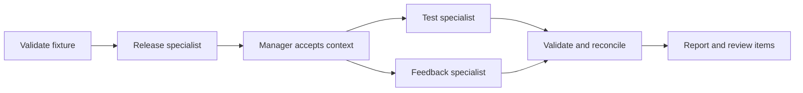

# Chain-of-Agents Orchestrator specification

Slug: 08-chain-of-agents-orchestrator
Status: demo-ready
Runtime: Python 3.14 (uv CLI)

## Problem and scope

Teach specialist delegation, typed handoffs, dependency gating, manager-owned working memory, and evidence reconciliation. Three deterministic specialists process structured synthetic release notes, test observations, and feedback. This is a fixture orchestration simulation. It does not interpret natural language, use an LLM, measure real software quality, or authorize deployment.

## Evidence and decisions

Source facts are inherited from the [Agent 08 brief](../../agent-library-analysis/agents/08-chain-of-agents-orchestrator.md) and [foundations](../../agent-library-analysis/foundations.md). Chapter 7 describes typed delegation, shared context, status tracking, synthesis, and arbitration. Its specialists use hardcoded values. Its arbitration sketch has incompatible field names and does not implement evidence-based resolution or escalation. Retained locators are printed pp.186–194, physical PDF pp.217–225. The purchased book was not re-verified for this implementation.

Selected decisions are a fixed workflow, deterministic structured evidence, immutable handoffs, no confidence score or source hierarchy, no retries, and run-scoped memory. [PLAN.md](PLAN.md) records alternatives and checkpoints. Persistent memory, live providers, arbitrary input paths, configurable graphs, MCP, and A2A are outside this contract. No material v1 decision remains open.

## Inputs and outputs

The CLI accepts a bundled fixture name and optional target release. It reads only packaged resources and prints one JSON result to stdout. It accepts no arbitrary file, executable, output path, or provider configuration. Fixtures cover consistent, contradictory, negative, missing-evidence, prerequisite-failure, downstream-failure, and timeout scenarios. README records exact names.

An evidence snapshot contains a target release, environment, and records belonging to `release`, `tests`, or `feedback`. Each record has a unique source/record identity, release, feature identifier, environment, and literal boolean `works` assertion. All claims are direct source assertions. This explicitly shared synthetic proposition makes comparison well-defined. A real failed test and user sentiment would not automatically establish the same proposition.

The boundary rejects unknown keys, wrong types including boolean/integer coercion, duplicate identities, invalid strings, unsupported releases, oversized resources, and malformed JSON. Limits are 256 KiB per snapshot, 100 records per role, and bounded identifiers/text. Exact string bounds must be documented with the parser. Source content is data, never executable instruction. Any synthetic fault controls belong to the packaged scenario, not specialist authority.

The selected JSON schema has exactly `target_release`, `environment`, and `records` at the top level. Each record has exactly `role`, `source_id`, `record_id`, `release`, `feature_id`, `environment`, `works`, and `text`. Identifiers are 1..64 ASCII characters matching `[A-Za-z0-9][A-Za-z0-9._-]{0,63}`. Text is 0..500 characters with no control characters except tab/newline. `(source_id, record_id)` must be globally unique across roles. The declared release and any override must occur in the snapshot's records. The environment remains the snapshot environment. Source text is retained in the immutable request but is never interpreted or copied into findings.

The release specialist establishes the nonempty feature catalogue for the target release/environment. Downstream specialists receive that accepted context and only their own scoped records. Other releases/environments cannot become target claims. An unknown target feature is rejected rather than silently expanding the catalogue. Reject duplicate JSON object keys as malformed input.

Accepted claims carry `(release, feature_id, environment)`, a boolean assertion, and source/record references with the snapshot SHA-256. The host verifies reference ownership and that the assertion matches the referenced record. An existing source ID alone is insufficient. Hashes identify input bytes, not truth.

Reports contain `mode=fixture`, run status, target scope, per-role states, accepted messages/claims, review items, and sanitized errors. Envelopes identify run, task, sender, recipient, and typed payload. Ordering is stable regardless of completion order; generated run IDs may differ.

Run statuses are `complete`, `review_required`, `failed`, and `timed_out`. External cancellation propagates `CancelledError` after child cleanup. The CLI handles interruption with exit 130 and a bounded diagnostic. Valid partial findings and review items remain visible on failed/timed-out runs. Invalid replies never enter accepted findings.

Exit codes are 0 for complete, 2 for review_required, 1 for input/execution/timeout failure, and 130 for interruption. Input errors yield a bounded diagnostic without a traceback or partial success report.

## Architecture and state

One public asynchronous analysis operation owns each run. Frozen dataclasses and closed enums/literals describe evidence, requests/replies, findings, review items, and task outcomes. Mutable run memory belongs solely to the manager. Specialists receive immutable snapshots. Runs share no mutable state and nothing survives a process restart.

Modules own contracts, evidence validation/loading, specialists, manager, and CLI. Packaged fixtures and the entry point must work from an installed wheel outside the repository. No sibling imports or root runtime configuration.

## Tools and authority

Specialists are deterministic local transformations. They return proposals and cannot write files, call services, spawn programs, select successors, or approve release. The manager is the sole task-state writer and acceptance authority.

Acceptance checks expected run/task identity, sender/recipient, running state, payload type, scope, record provenance, assertion consistency, and duplicate receipts. Findings must represent every assigned scoped record exactly once, so a specialist cannot hide dissent by omitting a record. The release catalogue must exactly match validated release records. Invalid envelopes or unsupported claims fail the task. Responses cannot alter execution policy or introduce specialists.

## Execution and termination

1. Load and validate a bounded fixture before any delegation.
2. Allocate fresh memory and three tasks. Each transitions from pending to running to one terminal state. Never-dispatched tasks may become blocked/cancelled.
3. Call release once and validate its context/findings before sharing them. Failure or timeout blocks both dependents.
4. Run tests and feedback concurrently. Validate replies before acceptance. Downstream failure cancels and drains unfinished siblings, retaining already accepted findings.
5. Reconcile exact `(release, feature_id, environment)` keys. Opposite assertions create unresolved contradiction items with both sides. Agreement cannot outvote dissent. Every negative observation and missing required per-feature role coverage also require review. Absence is unknown, never agreement.
6. Execution failure yields failed/timed_out with partial evidence/review items. Otherwise return review_required if any review item exists. Complete requires all roles done and full positive non-contradictory coverage.

At most three calls, no retries/replanning/human-wait loop. Default per-specialist timeout is one second and whole-run timeout three seconds. Any test-facing configurable limits must be finite, positive, and bounded. Timeouts are cooperative asyncio deadlines, not hard process isolation. Built-in specialists are bounded and cancellation-cooperative. Cancel and drain every started child before returning or propagating cancellation. Keyboard interruption cannot leave specialist tasks running.

The manager owns deadline enforcement and stops accepting results when deadlines expire. Asynchronous child cleanup may extend wall-clock duration beyond those deadlines; later deadlines must not interrupt cleanup with another cancellation.

Task terminal states distinguish done, failed, timed_out, cancelled, and blocked. Check the run deadline before dispatch and acceptance. Late results cannot change terminal state. Sanitize specialist exception messages; arbitrary exception text must not enter output.

## Acceptance criteria

All selected criteria use fixture evidence, including fake-specialist fault injection.

1. Consistent evidence completes with three typed results, exact references, and no review items.
2. Contradiction retains both sides in review_required. Duplicated positive records cannot erase dissent.
3. Negative-only and missing per-feature coverage require review. Other releases/environments neither conflict nor satisfy target coverage.
4. Downstream work starts only after accepted release context. Tests and feedback can make progress concurrently.
5. Invalid input fails before delegation. Forged identities, wrong payloads, assertion/provenance mismatch, cross-role references, and duplicates cannot be accepted.
6. Prerequisite failure blocks dependents. Downstream failure preserves partial evidence and cancels unfinished siblings. Timeouts are explicit and reject late results.
7. External cancellation propagates after cleanup. Concurrent/repeated runs remain isolated. At most three calls occur without retries.
8. Documented CLI scenarios produce expected JSON/status/exit codes. Help and invalid arguments behave predictably.
9. Case-only installation/tests work without siblings, credentials, or root PYTHONPATH. The built wheel runs packaged scenarios outside the checkout.
10. Independent review reconciles implementation, explanations, SPEC, README, authority, and evidence before demo-ready.

## Dependencies and open decisions

Python 3.14 standard library provides runtime behavior. uv manages the environment and lockfile. Pin build backend and pytest development dependencies during setup; no runtime dependency is required.

Official references checked during planning: [Python cancellation/timeouts](https://docs.python.org/3.14/library/asyncio-task.html), [uv configuration](https://docs.astral.sh/uv/concepts/projects/config/), [locking/syncing](https://docs.astral.sh/uv/concepts/projects/sync/), and [package builds](https://docs.astral.sh/uv/guides/package/). Fixture verification does not establish live-model quality, provider compatibility, hosted CI, or deployment readiness.
