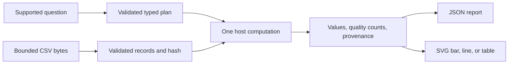

# Data Analysis Agent specification

Slug: 10-data-analysis
Status: demo-ready
Runtime: Python 3.14 (uv CLI)

## Problem and scope

Developers learn to translate a supported analytical question into a validated plan, reproducible calculations, and a chart using the same evidence. The original synthetic scenario is quarterly product activity. This deterministic workflow supports product rankings, monthly trends, and descriptive summaries. Its grammar is a constrained input language, not general conversational understanding.

No LLM, generated Python or SQL, network, database, statistical inference, forecasting, causality, imputation, normalization, outlier removal, or persistent conversation state is included. Follow-up refinement means another complete question with a narrower interval. No hidden context carries over.

## Evidence and decisions

Source facts inherited from the [retained brief](../../agent-library-analysis/agents/10-data-analysis.md): Chapter 8 describes intent, computation planning, execution, visualization, and interpretation, printed pp.204–211, physical PDF pp.235–242. It supplies illustrative snippets, not an end-to-end agent, sandbox, or statistical-assumption checker. The top-three-product demo is a proposal, not implementation evidence. The purchased source was not rechecked for this task.

Selected decisions: Python standard library, immutable records, three bounded operations, exact Decimal sums, one deep analysis API, and host-selected SVG rendering. The [plan](PLAN.md) records alternatives and design review. No material contract decision remains open.

## Inputs and outputs

`data-analysis --question TEXT [--dataset CSV] [--output DIRECTORY]` reads packaged synthetic CSV unless an explicit local CSV is selected. The optional output directory receives `report.json` and `chart.svg`. The complete outcome is JSON on stdout. Default execution writes no files.

Only these case-insensitive, fully matched forms are supported. Surrounding whitespace may be trimmed. Unknown fields, incomplete periods, extra clauses, and code-like instructions return `needs_clarification` without calculations or artifacts.

```text
top N products by METRIC from YYYY-MM-DD to YYYY-MM-DD
monthly METRIC from YYYY-MM-DD to YYYY-MM-DD
describe METRIC from YYYY-MM-DD to YYYY-MM-DD
```

`METRIC` is `units` or `revenue_rm`. `N` is an ASCII integer 1–10. Dates are inclusive, valid ISO calendar dates in years 2000–2100, ordered, and cover at most 366 days inclusive. Questions are at most 256 characters. Invalid dates or metrics request clarification without substituting an interpretation.

CSV is UTF-8, at most 256 KiB, with exactly the ordered unique headers `date,product,units,revenue_rm`. It has 1–1000 records of exactly four fields. Record ordinals start at 1 after the header and identify CSV records, not physical text lines. Date/product pairs are unique. Dates follow the same date domain. Products contain 1–40 printable ASCII characters with no surrounding spaces; at most 20 distinct products are allowed. Markup characters are data and are escaped on display.

Units are blank or a nonnegative ASCII integer no greater than 1,000,000,000. Revenue is blank or a nonnegative ASCII decimal with at most two fractional digits and value no greater than 1,000,000,000.00. Nonempty numeric tokens are at most 13 characters. Reject exponents, signs, Unicode digits, NaN, Infinity, and underscores. Blank means missing; an observed zero is a value. Malformed records invalidate the dataset even outside the requested interval. Reject non-regular files and symlink leaf inputs, perform a bounded read, and never derive paths from data.

Success contains the normalized `AnalysisPlan`, selected metric/unit, calculations, host-selected chart kind/data, deterministic interpretation, assumptions, SHA-256 of exact dataset bytes, and record provenance. Include total, in-period, outside-period, used, and missing-metric record counts, missing record ordinals, and contributing ordinals for each aggregate. Identify the deterministic backend and built-in synthetic source. User-supplied data must not be claimed synthetic or complete.

Decimal values serialize as strings, never JSON float approximations. Sums are exact within this bounded domain using local Decimal precision 40. Mean, median, and sample standard deviation display six fractional digits with ROUND_HALF_EVEN. Monetary sums use two decimals; unit sums use integer strings. JSON contains no nonfinite numeric literals.

## Architecture and state

`analyze(question, dataset_bytes, source_label)` owns one request and returns a typed terminal outcome. The CLI owns bounded file reading and optional publication. Immutable plans distinguish rank, monthly trend, and describe. Dataset validation owns uniqueness and schema rules; calculation owns metric semantics. Rendering consumes computed values and never recomputes totals.

State is immutable and run-scoped. No session store, cache, credentials, or sibling imports are needed. Keep a small module set for domain types, analysis, rendering, and CLI. Define observation units, provenance, missingness, and authority alongside code. The README links actual source entry points.



## Computation and missing-data policy

Results describe observed records. This schema has no declared product/date population; missing rows cannot establish coverage or business truth. Never infer absent products have zero activity or a period is complete.

After inclusive date filtering, exclude only blank selected-metric values and disclose their ordinals. Missing values of the other metric do not affect the calculation. No matching records or no observed selected values yields `no_data`, quality counts, and no chart/artifacts.

- **Rank.** Sum each observed product, sort descending by total then ascending by exact product label, and return at most N products. Omit products without observed selected values. Attach contributing ordinals. Use a zero-baseline bar chart. Any in-period missing selected value requires an explicit incomplete observed-subtotal warning.
- **Monthly trend.** Sum by calendar month and return every intersecting month chronologically. Clip each bucket to the interval and mark partial calendar months. A bucket without an observed value has a null total, never zero. Disclose per-bucket missing counts. Draw gaps for null months. Use a line chart if at least two months have observed values, otherwise an SVG table. No growth rate or interpolation is inferred.
- **Describe.** Observations are the selected nonmissing product/date records, not transactions, product totals, or monthly totals. Return count, sum, minimum, maximum, mean, median, and sample standard deviation using denominator n−1. For n=1, standard deviation is null with an explanation. Use an SVG table. These statistics provide neither statistical confidence nor causal evidence.

## Tools and authority

Only three host plans execute. Query text never becomes code, SQL, paths, or raw chart markup. No eval, exec, subprocess, model tools, or runtime network is permitted. Data is read-only; plans/labels are untrusted until validated.

Artifact publication is opt-in. The destination must be new and cannot traverse symlink parents. Existing destinations fail unchanged. Create the directory exclusively; write the two completed artifacts. On caught write failure or interruption, remove only files and the directory created by this invocation. Competing commands cannot both own one destination. This is no-overwrite and caught-failure cleanup, not crash-atomic publication or a defense against hostile concurrent filesystem changes. A process kill or power loss may leave partial output; later runs refuse to overwrite it. Document inspection/removal before reusing that path.

The CLI main thread briefly defers SIGINT during directory/file creation and cleanup registration, then restores the previous handler and delivers pending cancellation inside the cleanup boundary. Writes remain interruptible. This closes syscall/ownership gaps for real Ctrl-C signals; arbitrary asynchronous Python exception injection is not an atomicity guarantee.

## Execution and termination

1. Validate bounded question and CLI options; unsupported intent requests clarification.
2. Load one bounded dataset and validate all records before calculation.
3. Validate one typed plan, filter records, and execute one allowed operation.
4. Return values, assumptions, provenance, quality counts, and deterministic interpretation.
5. Optionally publish artifacts from that result and exit.

No retries or self-repair exist. Bounds cover question, bytes, rows, products, numeric magnitude, and at most 13 month buckets. Caught KeyboardInterrupt yields `cancelled`, exit 130, and owned-artifact cleanup. Other exits are 0 completed, 2 needs_clarification/no_data, 3 invalid_dataset/input_error/output_error. Invalid CLI options may use argparse exit 2. Expected failures produce structured concise errors without raw file content or tracebacks. Source files never change; programming failures cannot masquerade as successful analysis.

## Acceptance criteria

All selected criteria use fixture mode and must pass before demo-ready.

1. Top-three quarterly revenue totals match independent sums, ordering, chart values, and record provenance. Decimal fractions never pass through floats for arithmetic.
2. Dates are inclusive; excluded rows are counted. Ties use exact product ordering. Narrowing the interval changes results.
3. Monthly buckets are ordered/clipped and distinguish unknown, zero, and missing. SVG lines do not bridge null months; one observed month uses a table.
4. Row-level describe matches independent summaries, sample standard deviation, singleton/empty limits, and documented rounding.
5. Missing selected values are disclosed without imputation. Other-metric missing values have no effect. All missing selected values yields no_data.
6. Unsupported metric/date/query clauses clarify without calculations or artifacts. Invalid schemas, duplicate records, malformed/nonfinite numbers, size limits, and non-regular files fail explicitly.
7. JSON and SVG use one result; markup labels remain text. Hashes match exact source bytes, which remain unchanged.
8. Default writes no artifacts. Output creates both files, refuses existing/symlink paths, and preserves prior files. Injected failure/interruption checks establish caught-failure cleanup.
9. Documented CLI, tests, case-only installation, and installed wheel work without siblings or credentials. Independent review has no unresolved correctness issues. Root structure and whitespace checks pass.

## Dependencies and open decisions

Python 3.14 standard library runtime, `hatchling==1.32.4` packaging, `data_analysis_agent` source package with bundled synthetic CSV, case-local uv.lock, .python-version, and ignore rules. Tests use unittest; no .env is needed.

Official documentation checked on 2026-10-21: [CSV](https://docs.python.org/3.14/library/csv.html), [Decimal](https://docs.python.org/3.14/library/decimal.html), [statistics](https://docs.python.org/3.14/library/statistics.html), [JSON](https://docs.python.org/3.14/library/json.html), [package resources](https://docs.python.org/3.14/library/importlib.resources.html), [Hatchling](https://pypi.org/project/hatchling/1.32.4/), and [uv](https://docs.astral.sh/uv/concepts/projects/sync/). Documentation checks are not runtime evidence.
