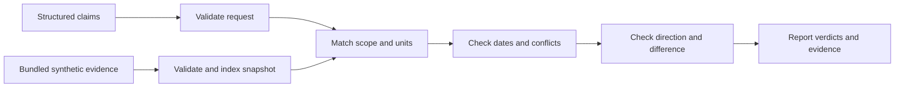

# Verification and Validation Agent specification

Slug: 11-verification-and-validation
Status: demo-ready
Runtime: Python 3.14 (uv CLI, POSIX)

## Problem and scope

Verify structured synthetic release statistics against one bundled, versioned truth snapshot. Reviewers can inspect exact scope matching, signed direction, dimensions, evidence eligibility, conflicts, and numerical comparisons. Verdicts describe this synthetic evidence, not real-world truth. Natural-language extraction, NLI, credibility estimates, arbitrary logical proofs, external retrieval, durable review queues, and publication are outside scope.

## Evidence and decisions

The retained [source brief](../../agent-library-analysis/agents/11-verification-and-validation.md) describes verification and a simulated newsroom dictionary. Its fallback loses the sign of “fell by 5%.” Locators are Chapter 8, printed pp.211–215 and 220–226, 1-based PDF pp.242–246 and 251–257. These are retained analysis findings, not new PDF inspection or executed book evidence.

Selected decisions are structured signed claims, standard-library validation and Decimal arithmetic, fixed bundled authority, per-record validity windows, and one document verification operation. The [plan](PLAN.md) records alternative designs. No book performance claim or universal tolerance is adopted.

## Inputs and outputs

The CLI accepts one regular JSON file containing exactly `as_of` and `claims`.

```json
{
  "as_of": "2026-10-21",
  "claims": [{
    "id": "latency-fall", "entity": "atlas", "metric": "latency_change",
    "period": "2026-Q3", "baseline_period": "2026-Q2",
    "value": "-5", "unit": "relative_percent"
  }]
}
```

There are 1–32 claims, all fields are required, and IDs are unique. Identifiers start with a lowercase ASCII letter and contain at most 64 lowercase letters, digits, underscores, or hyphens. Unknown well-formed entities and metrics remain valid and can be unverified.

Periods use exact `YYYY-Q[1-4]` with years 0001–9999. A non-null baseline precedes the target. Known level metrics require null baseline; known change metrics require a baseline. Unknown metrics permit either form. A different baseline cannot borrow evidence from another scope.

Values are decimal strings with optional minus, 1–12 integer digits, and at most 6 fractional digits. Reject leading zeroes except `0`, plus signs, whitespace, exponents, JSON numbers, booleans, NaN, and infinities. Normalize zero; it has no direction. Use a private arithmetic precision of at least 32 digits, independent of ambient Decimal context.

Recognized units are `count`, `milliseconds`, `relative_percent`, and `percentage_point`. Relative percentages and percentage points are distinct dimensions. No conversion, fuzzy matching, inferred direction, or implicit baseline exists. Unknown unit tags are invalid input. Recognized incompatible units produce `unverified/unit_mismatch` before numeric comparison. Apply domain bounds only for compatible units.

The bundled snapshot owns these selected rules. Tolerances are inclusive absolute differences in the canonical unit.

| Metric | Unit | Baseline | Tolerance | Domain |
| --- | --- | --- | --- | --- |
| `latency_change` | `relative_percent` | Required | `0.5` | Signed |
| `adoption_change` | `percentage_point` | Required | `0.5` | -100 to 100 |
| `resolved_tickets` | `count` | Null | `0` | Nonnegative integer |
| `latency` | `milliseconds` | Null | `1` | Nonnegative |

Requests are at most 65,536 bytes. Reject invalid UTF-8, duplicate JSON keys, unknown fields, wrong types, malformed nesting, invalid dates/periods/baselines/quantities, excessive claims, and compatible values outside metric domains atomically. Dates require exact `YYYY-MM-DD` plus calendar validation. `as_of` is an explicit caller-selected evaluation date, not a present-day freshness guarantee.

The report includes snapshot version and SHA-256 of its exact bytes, evaluation date, ordered results, and derived `review_required`. Each result contains the normalized claim, verdict, stable reason, eligible evidence, excluded evidence and exclusion reasons, expected value when unambiguous, difference when compared, and applied tolerance. Evidence includes ID, scope, value, unit, source label, and inclusive validity dates. Missing/conflicting evidence never produces an invented expected value.

Verdicts are `confirmed`, `mostly_true`, `contradicted`, and `unverified`. `mostly_true` means only a nonzero numerical difference within this demo's tolerance. Review is required unless all results are `confirmed`.

## Architecture and state

The public operation is `verify_document(document: bytes) -> Report`. It parses the request, loads the fixed package resource, validates authority, indexes records, checks claims, and returns immutable run-scoped results. Invalid input or evidence raises a typed error before any partial report.

The exact scope key is `(entity, metric, period, baseline_period)`. Preserve every matching record; never overwrite duplicates. The snapshot owns metric rules and evidence. The caller owns claims and evaluation date. No state survives the call. Domain types include Scope, Quantity, Claim, MetricRule, Evidence, Result, and Report. Keep module count small and explanations beside the code.



## Tools and authority

Read only the explicitly named request and fixed package evidence. Write only stdout/stderr. No caller truth path, URL, tolerance override, source precedence override, output path, credentials, model, network, runtime subprocess, or durable state exists. Inputs and evidence remain unchanged.

Bound both reads, accept only regular files, and reject final-component symlinks and special files promptly without waiting on FIFOs. This is input hygiene, not an OS sandbox. A local administrator can alter installed files; a hash identifies bytes rather than authenticating them.

The snapshot is at most 262,144 bytes with 1–256 records and 1–16 metric rules. Validate exact fields, version, unique record IDs and metric names, canonical units, domains, nonnegative tolerances, baseline requirements, and ordered validity dates. Unknown evidence metrics and inconsistent evidence units/domains are source errors. Equal-valued records corroborate; differing eligible values conflict regardless of tolerance. No record has higher implicit authority.

### Selected snapshot and report schemas

The fixed resource is `src/verification_agent/data/truth-v1.json`, installed within the `verification_agent` package. Its root has exactly `version`, `metrics`, and `records`. `version` uses the identifier grammar above; the bundled value is `truth-v1`. All object fields are required and additional fields are rejected.

Each metric rule has exactly `metric`, `unit`, `baseline`, `tolerance`, and `domain`. The metric name uses the identifier grammar. Tolerance uses the quantity decimal grammar and is nonnegative. Allowed `(unit, baseline, domain)` combinations are `(count, none, nonnegative_integer)`, `(milliseconds, none, nonnegative)`, `(relative_percent, required, signed)`, and `(percentage_point, required, percentage_point)`. The last domain restricts values to [-100, 100]. These combinations validate dimension and baseline consistency; the selected four metric names and tolerances remain those in the table above.

Each evidence record has exactly the claim fields plus `source`, `valid_from`, and `valid_through`. `source` is a 1–120 character label with no leading/trailing whitespace or Unicode category-C characters. Both validity fields use the strict calendar-date grammar; the first cannot follow the second. All records, including scopes not requested, must validate before verification begins.

Serialized reports have exactly `snapshot_version`, `snapshot_sha256`, `as_of`, `results`, and `review_required`. A result has `claim`, `verdict`, `reason`, `eligible_evidence`, `excluded_evidence`, `expected_value`, `difference`, and `applied_tolerance`. Claims and evidence retain the flat scope fields shown in the input example. Each excluded item is `{"evidence": <record>, "reason": "expired" | "not_yet_valid"}`. Decimal fields serialize as normalized strings, with trailing fractional zeroes removed and any signed zero represented as `"0"`. Dates serialize as ISO calendar dates.

`difference` is the absolute claim/expected difference. Expected value, difference, and tolerance are null for unverified results; compared results include all three, including direction reversals. Eligible and excluded lists each sort by evidence ID. Only exact-scope, dimension-compatible records enter these lists; unknown metrics, dimension mismatches, and missing scopes return empty lists. Every result except `confirmed` contributes to `review_required`.

## Execution and termination

1. Validate the complete request and complete snapshot. Invalid data yields no report.
2. Unknown metric yields `unverified/unknown_metric`; incompatible unit yields `unverified/unit_mismatch`; no exact scope yields `unverified/missing_evidence`.
3. Eligibility requires `valid_from <= as_of <= valid_through`. Retain excluded records with `expired` or `not_yet_valid` reasons. No eligible record yields `unverified/no_current_evidence`.
4. Differing eligible values yield `unverified/conflicting_evidence`, retaining all records. Equal values corroborate. Excluded conflicts do not defeat eligible agreement.
5. Opposite nonzero signs for change metrics yield `contradicted/direction_reversed` before tolerance. Zero follows numerical comparison.
6. Exact equality yields `confirmed/exact_match`; nonzero difference at or below tolerance yields `mostly_true/within_tolerance`; larger differences yield `contradicted/outside_tolerance`.
7. Preserve claim order, sort evidence by ID, derive review status, and emit one complete JSON report. Bounds make the single pass finite. No retries or repair loops occur.

Exit 0 means a report was produced, including unfavorable verdicts; `--help` also exits 0 with usage text. Exit 2 rejects invalid/unreadable input or CLI syntax. Exit 3 means invalid/unavailable evidence. Errors use stable concise codes without raw input, tracebacks, or absolute paths. Keyboard interruption exits 130 with no report if interrupted before output. Broken output pipe exits 1. Process termination leaves no state to recover.

## Acceptance criteria

All criteria use fixture mode.

1. Exact level/change claims confirm with correct scope, record IDs, units, and independently recomputed snapshot digest.
2. Opposite signs contradict even under deliberately broad test tolerance. Zero follows numeric rules.
3. Missing entity/metric/target/baseline never borrows evidence. Unit mismatch never compares numbers.
4. Inclusive tolerance boundaries are `mostly_true`; one supported decimal step outside contradicts. Ambient Decimal precision cannot change verdicts.
5. Expired/future-only evidence is unverified, boundary dates are eligible, and exclusions remain auditable.
6. Conflicting eligible records remain unverified independent of order. Equal records corroborate with all IDs.
7. Invalid schema/types/keys/IDs/dates/periods/baselines/values and excessive input fail atomically with exit 2.
8. Invalid, oversized, missing, unreadable, or inconsistent evidence fails with exit 3. Symlink and special-file inputs fail promptly.
9. Mixed batches preserve order, derive review, and repeat deterministically. Input/evidence bytes remain unchanged.
10. Documented CLI/tests run from a case-only copy and installed wheel with packaged evidence, no sibling cases, credentials, or PYTHONPATH.

## Dependencies and open decisions

Use locally available Python 3.14.8, standard-library runtime/tests, and Hatchling 1.32.4 for packaging. [PyPI](https://pypi.org/project/hatchling/1.32.4/) and [Hatch package selection](https://hatch.pypa.io/latest/config/build/) were checked on 21 October 2026. Package evidence must survive wheel installation.

Official [Decimal](https://docs.python.org/3.14/library/decimal.html), [JSON](https://docs.python.org/3.14/library/json.html), and [date](https://docs.python.org/3.14/library/datetime.html#datetime.date.fromisoformat) documentation informed explicit precision, duplicate/nonfinite rejection, and lexical date validation. No product decision remains open. Live-model and deployment modes are not implemented.
