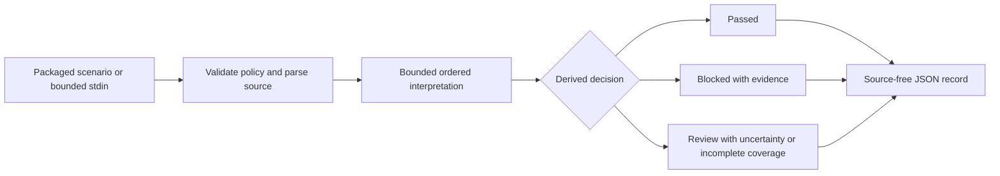

# Agent 14 implementation plan

The user selected the chapter's Compliance-Driven pattern on 22 October 2026. Completed one independently runnable case at `agents/14-security-and-compliance/`. [SPEC.md](SPEC.md) is the behavior authority.

## Design decision

| Candidate | Shape | Assessment |
| --- | --- | --- |
| A | Pure interpreter with immutable source-origin sets and transactional prefix stopping | Selected. Unsupported syntax cannot contaminate later claims. |
| B | AST scanner that continues after unsupported statements, invalidating bindings | Rejected continuation strategy. It requires additional state recovery for one rule. |
| Alternative considered by both | Extracted fact graph and general policy engine | Deferred. A second schema and plugin layer do not help this single-policy demo. |

Independent cross-judge agreed with candidate A on all five design criteria. Adopt candidate B's stdout-only reports. Add bounded stdin and packaged scenarios so neither input path confinement nor audit persistence becomes a second project. These are design assessments, not test evidence.

The Model the Domain principle led to immutable origin sets and a status derived from findings. Separate Before Serializing Shared State led to one builder in an isolated checkout and invocation-local runtime state. Prove It Works requires actual CLI, copied-case, installed-wheel, and independent-review evidence.

## Intended use and interfaces

```sh
uv run --locked compliance-agent --scenario blocked
uv run --locked compliance-agent --scenario clean
printf 'logger.info("public event")\n' | uv run --locked compliance-agent --stdin
```

The last command supplies caller-controlled stdin; the package opens no user path. The ten packaged scenario names and outcomes are documented in README. The public core call is `assess(source_bytes, validated_policy)`. It returns immutable findings and coverage. The CLI owns bytes, policy validation, JSON and exit codes.



## Sequence and ownership

1. Ground source and repository requirements. Completed. Retained brief, inventory, foundations, templates and current Python documentation reviewed.
2. Compare designs and fix the input/output/state/authority contract. Completed. User selected chapter scope; independent cross-judge agreed with the synthesis.
3. Build package, policy, scenarios, tests and local usage docs. Completed by the builder in an isolated checkout. Root owns catalogue and final integration.
4. Verify semantic boundaries and real CLI results. Completed. All 42 tests and 86 independent CLI invocations passed in the integrated case. README records exact commands and evidence limits.
5. Run independent correctness, authority, isolation and explanation review. Completed. Both reviewers found no actionable issues. Parser-warning leakage was identified and fixed before review, with real CLI regressions.
6. Verify copied-case installation and installed wheel. Completed. The copied case passed all 42 tests. A wheel built from its source distribution passed all 86 independent CLI invocations in a fresh environment. Policy, scenarios and license were present.
7. Synchronize status and catalogue, then run root structure and whitespace checks. Completed. The case is demo-ready for its fixture contract. No publication or deployment was performed.

## Throughput checkpoint

- Blocking first steps completed before implementation: user scope, source/API evidence, repository ownership, synthesized contract.
- Independent workstreams: source research and repository grounding ran in parallel; independent design candidates ran separately.
- Shared mutable state: builder used its own checkout; root integrated only after it returned. Reports have no shared runtime store.
- Smallest safe decomposition: one builder owns interpreter, policy, CLI and tests because their grammar and outcomes must agree. Review and package verification are independent read-only work after implementation.

## Evidence boundaries

The selected demo uses synthetic fixtures and no runtime model or network. Mocked-provider, live-model, hosted CI, deployment, legal compliance, real Python SAST accuracy, and immutable audit storage are outside the demonstrated scope. A runnable CLI alone does not establish acceptance readiness. See README for actual verification records.
