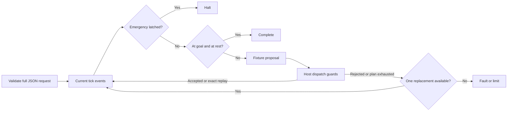

# Embodied Intelligence Agent

Slug: 30-embodied-intelligence
Status: demo-ready
Runtime: Python 3.14 (uv CLI)

## Purpose

Run an original, wholly synthetic one-dimensional cart. Fixture plans propose integer velocities. The host dispatcher checks current version, track limits, speed, battery, and the whole motion segment before one simulated effect. Accepted commands receive replayable receipts. Emergency stop latches before pending motion or replay. The run allows at most 20 command attempts and one replacement plan.

This is a learning simulator with no hardware, ROS, network, model, real-time, or physical safety qualification. [SPEC.md](SPEC.md) defines the exact schema, dynamics, output, error and stopping semantics.

## Run the demo

From this directory, with uv and Python 3.14 available:

```sh
UV_CACHE_DIR=/tmp/agent-atlas-uv-cache uv sync --offline --locked
UV_CACHE_DIR=/tmp/agent-atlas-uv-cache uv run --offline embodied-cart --fixture normal
UV_CACHE_DIR=/tmp/agent-atlas-uv-cache uv run --offline python -m embodied_intelligence --fixture emergency
UV_CACHE_DIR=/tmp/agent-atlas-uv-cache uv run --offline embodied-cart --input src/embodied_intelligence/fixtures/replan.json
```

`--offline` requires cached Python/build dependencies. If the cache is empty, run `uv sync --locked` with network access first. The runtime has no external dependencies. Hatchling 1.32.4 builds the wheel.

Normal output is one JSON report with `outcome: complete`, `ticks: 4`, final position 7, final velocity 0, battery 19, and version 4. Its trajectory is 0 → 3 → 6 → 7 → 7, spending 4 + 4 + 2 + 1 battery units. Reports preserve initial/final state, every command attempt, every host effect and any unprocessed events. No runtime state persists between invocations.

Fixtures are `normal`, `replan`, `emergency`, `obstacle`, `replay`, and `tick-limit`. `replan` rejects the first excessive-speed proposal, then executes a replacement. `replay` acknowledges an accepted action without moving twice. `obstacle` faults before crossing the obstacle. `emergency` halts after one command and suppresses a same-tick obstacle update. `tick-limit` stops after 20 zero-speed commands.

The CLI returns 0 for complete/halted, 1 for fault/limit, 2 for invalid arguments/input, and 130 for interruption. Invalid errors contain fixed codes without supplied text or paths. Help and result output handle closed pipes quietly in buffered and unbuffered Python. Input is a bounded regular JSON file or a packaged fixture, never stdin. No report file is written.

## Understand the control boundary

A motion command moves by its requested velocity for one abstract tick and costs `1 + abs(velocity)`. Valid speed is -3..3, track position is 0..100, and a point obstacle blocks any closed motion segment containing it. Expected version must match current state at dispatch. An exact accepted-command replay returns the original receipt without repeating any effect. A changed command under that accepted ID is rejected.

Emergency events precede motion, replay, goal checks and other same-tick events. They latch permanently within the run. Every terminal outcome has zero velocity. The host records a separate zero-displacement, zero-energy `brake` effect when needed, incrementing the version. Thus a rejected command itself changes no state, while terminal freezing remains visible in the trace. This simplified brake has no physical stopping-distance meaning.



The code also enforces the tick limit before requesting the next command. A replacement discards the old plan's remaining commands. Events are synchronous fixture data, not a real emergency input interface.

## Source reading guide

- [cli.py](src/embodied_intelligence/cli.py) owns argument parsing, regular-file reads, fixture selection, sanitized errors and explicit stdout flushing. [__main__.py](src/embodied_intelligence/__main__.py) is the module entry point; `embodied-cart` calls `cli.main`.
- [schema.py](src/embodied_intelligence/schema.py) defines immutable state/command/event/request records and validates the entire bounded JSON request before simulation.
- [simulator.py](src/embodied_intelligence/simulator.py) contains Dispatcher authority, exactly-once receipt handling, point-obstacle guards, fixture planner, event ordering, bounded run flow and terminal brake semantics.
- [Packaged fixtures](src/embodied_intelligence/fixtures/normal.json) are original proposals and world events. They are data; only the host grants simulated effects.
- [test_cart.py](tests/test_cart.py) checks the independent motion/energy oracle, rejection immutability, crossing direction, versions, replay, emergency precedence, limits and real CLI processes.
- [qualify.py](qualify.py) copies this case alone, runs its tests and CLI outside the repository, builds a wheel, removes the copied source, and reruns tests plus both installed entry points using packaged resources.
- [PLAN.md](PLAN.md) records implementation decisions. The [source brief](../../agent-library-analysis/agents/30-embodied-intelligence.md) distinguishes book facts and listing defects from this original implementation.

## Verification

```sh
UV_CACHE_DIR=/tmp/agent-atlas-uv-cache uv run --offline python -m unittest discover -s tests -v
UV_CACHE_DIR=/tmp/agent-atlas-uv-cache uv run --offline python qualify.py
```

Verified on: 2026-10-23
Verification command: `UV_CACHE_DIR=/tmp/agent-atlas-uv-cache uv run --offline python -m unittest discover -s tests -v`
Verification mode: fixture
Verification result: passed
Verified scope: 43 tests cover integer trajectory, energy/version conservation, no rejected-command effects, full-segment obstacles, action replay, world updates, emergency latching and ordering, bounded replanning/ticks, terminal braking, strict JSON, regular-file reads, sanitized arguments and actual buffered/unbuffered closed stdout processes.

Verified on: 2026-10-23
Verification command: `UV_CACHE_DIR=/tmp/agent-atlas-uv-cache uv run --offline python qualify.py`
Verification mode: fixture
Verification result: passed
Verified scope: Case-only copy and installed wheel each pass the 43-test suite outside the repository. Each also runs all six fixtures and help through module and console entry points. Wheel tests run after copied build source removal, with isolated Python, a fresh environment and package-origin verification.

The recorded environment is CPython 3.14.8, uv 0.12.23, and cached Hatchling 1.32.4 on macOS arm64. These are local fixture results. Independent substantive review passed the source/copy/wheel checks, 22,725 dispatcher combinations and 3,000 seeded parsed-request scenarios. Status is demo-ready for the documented fixture contract. Live model, real hardware/service, deployment and production behavior are unverified and outside this contract.

## Limits and attribution

The simulator omits acceleration, inertia, sensor uncertainty, wall-clock timing, concurrent inputs and collision recovery. Velocity is the last simulated tick's speed; no tick or coasting happens without a command. Replay identity lasts only for one run. A new run creates a new synthetic world and does not authorize real equipment restart.

Inspired by the Embodied Intelligence pattern in Imran Ahmad, *30 Agents Every AI Engineer Must Build*, Packt, March 2026, Chapter 16, printed pp.460-473. The repository's [source analysis](../../agent-library-analysis/agents/30-embodied-intelligence.md) records limitations. Implementation and fixtures are original; no purchased pages or source listings are included.
