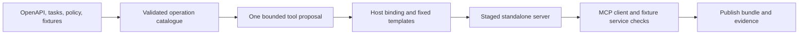

# MCP Server Builder Agent specification

Slug: 32-mcp-server-builder
Status: planned
Runtime: Python (uv CLI; planned)
Library ID: 32 (project extension; not a book reference ID)

## Problem and scope

Help an integration developer turn an existing REST service into a small, reviewable MCP server. The developer supplies an OpenAPI document, the tasks clients need to perform, and a host-owned service policy. The agent selects relevant operations and proposes tool names and descriptions. Deterministic code validates that proposal, builds a standalone server, and checks the generated artifact.

The learning objective is agent-assisted interface design with executable authority boundaries. Mechanical schema conversion alone does not demonstrate semantic agent behavior. The generated MCP server needs no model at runtime.

The first demo uses an original synthetic customer-and-invoice service. The request is to find a customer, list that customer's invoices, and inspect an invoice. Three approved GET operations support those tasks. The fixture also contains an unrelated read operation and a payment-writing operation to demonstrate exclusions. Each exposed tool maps to exactly one upstream operation. No automatic multi-tool workflow is generated.

Selected MVP boundaries are one local OpenAPI JSON document, up to three curated read-only tools, a standalone Python server, and stdio transport. Source-code ingestion, web crawling, write operations, custom authentication flows, remote MCP hosting, client installation, and deployment are deferred. Planning this case does not implement any of them.

## Evidence and decisions

Official sources inspected on 2026-10-21:

- **Source facts:** [MCP versioning](https://modelcontextprotocol.io/docs/2026-07-28/learn/versioning) identifies `2026-07-28` as current. [Discovery](https://modelcontextprotocol.io/specification/2026-07-28/server/discover) requires servers to implement `server/discover`. Requests carry version and client-capability metadata. A legacy `initialize` handshake alone does not establish conformance to this revision.
- **Source facts:** The [tools specification](https://modelcontextprotocol.io/specification/2026-07-28/server/tools) defines tool discovery, invocation, schemas, and errors. Declared output schemas constrain structured results, which may contain any JSON value. [Tool annotations](https://modelcontextprotocol.io/specification/2026-07-28/schema#toolannotations) are hints, not guarantees of permission or behavior.
- **Source facts:** [Stdio](https://modelcontextprotocol.io/specification/2026-07-28/basic/transports/stdio) uses a subprocess and reserves stdout for protocol messages. The [authorization specification](https://modelcontextprotocol.io/specification/2026-07-28/basic/authorization#protocol-requirements) distinguishes stdio credential handling from HTTP authorization. [Token passthrough](https://modelcontextprotocol.io/specification/2026-07-28/basic/authorization/security-considerations#access-token-privilege-restriction) is forbidden for authenticated MCP proxies.
- **Source facts:** The official [Python SDK](https://py.sdk.modelcontextprotocol.io/get-started/installation/) and [TypeScript SDK](https://ts.sdk.modelcontextprotocol.io/v2/) document stable v2 releases. Python requires 3.11 or later. Exact installed compatibility has not been tested here.
- **Source facts:** [OpenAPI 3.2.1](https://spec.openapis.org/oas/v3.2.1.html) is the latest published specification at inspection. [OpenAPI 3.1.1](https://spec.openapis.org/oas/v3.1.1.html) describes parameter locations, inheritance, serialization, references, and security overrides. Selecting a 3.1 profile below is an intentional coverage limit.
- **Repository context:** The retained [Code Generation brief](../../agent-library-analysis/agents/13-code-generation.md) informs bounded generation and independent checks. [Foundations](../../agent-library-analysis/foundations.md#6-tools-orchestration-and-interoperable-contracts) distinguish protocol compliance from generic structured messages. The [inventory](../../agent-library-analysis/agent-inventory.md) retains its source identities. This extension does not implement or renumber the supplemental Domain-Transforming Integration pattern.

**User-selected decision:** OpenAPI specification first, with a short description of desired tools.

**Selected design decisions:** constrained tool proposals, deterministic templates, Python for builder and generated server, official MCP SDK, stdio, independent generated artifacts, one proposal attempt, fixture verification before publication, and no service writes. Python keeps the first implementation in one language. TypeScript remains a valid alternative, not an inferior or experimental SDK choice.

**Inference:** copying OpenAPI schemas is insufficient to build a correct adapter. HTTP serialization, permission, errors, and protocol behavior need their own checks. A passing synthetic fixture suite does not prove that a real service matches its OpenAPI document.

**Open implementation choices:** exact Python and dependency pins, model provider and identifier, and the concrete process/network isolation mechanism. [PLAN.md](PLAN.md) makes their resolution an implementation gate. No real target service or client application has been selected.

## Inputs and outputs

### Build input

The proposed `BuildRequest` contains paths to `openapi.json`, a UTF-8 task brief, a service policy, a verification fixture set, an explicit planner mode, and a new output directory under this case's `artifacts/`. Snapshot and hash these inputs before planning. Inputs must be regular files within the case input root, with no symlink escape. Reject duplicate JSON keys, malformed data, unknown policy fields, and exceeded bounds. Fixture sets contain declarative synthetic requests and expected responses only; they cannot supply executable tests or commands.

The task brief identifies required tasks and may name required operations. It cannot authorize tools. The service policy supplies an explicit operation allowlist, required selections where applicable, approved destination, credential environment-variable name when needed, and execution limits. A GET method is only a syntax restriction; the operator must attest that each allowed operation is appropriate for read-only use.

An `OperationKey` is a canonical method plus path, with an OpenAPI JSON Pointer for provenance. Do not depend on optional `operationId` values for identity. Duplicate `operationId` values in a document that supplies them are invalid.

The model returns a `ToolProposal` containing selected operation keys, unique names, concise descriptions, task-to-operation associations, and uncovered tasks. It cannot return executable expressions, endpoints, parameter mappings, schemas, credentials, dependency choices, or test expectations. Host code derives those from the supported source contract and policy. Task associations aid review; their structural validity does not prove semantic correctness.

### Deliberate OpenAPI profile

The first implementation accepts `openapi: 3.1.1` JSON only. Other versions, including 3.0 and 3.2, require later explicit support. This is not a claim that 3.1.1 is current.

| Area | Selected behavior |
| --- | --- |
| Operations | GET without a request body; at most three selected tools; one declared `200 application/json` success response per selected operation. |
| Parameters | Scalar string, integer, number, or boolean path/query values. Resolve path-item inheritance and operation-level replacement by `(in, name)`. Path parameters are required. Accept simple path and form query serialization only; reject other styles, content-valued parameters, and reserved expansion. |
| Tool arguments | Derive separate `path` and `query` object properties, preserving upstream names and requiredness. Reject unknown fields and type coercion. No aliases or model-authored transformations. |
| Schemas | Explicit single `type`; object, array, string, integer, number, boolean, or null. Support `properties`, `required`, `items`, `enum`, numeric minimum/maximum, string length, and array length bounds. Objects must explicitly set `additionalProperties: false`. Preserve optional properties; do not inject defaults. |
| Schema exclusions | No unions/composition, recursive schemas, custom dialects, `format`, `pattern`, or arbitrary properties. Validation keywords outside the declared subset reject the affected operation. `title` and `description` remain inert metadata. |
| References | Acyclic same-document JSON Pointers under `components/schemas` only. Reject external references without fetching them. Resolve with count, expansion-size, and depth limits. |
| Authentication | No authentication, or one effective HTTP bearer scheme with a token supplied through a host-named environment variable. Resolve root security and operation overrides, including an explicit empty override. Reject OR/AND combinations, OAuth flows, cookies, query API keys, and ambiguous schemes. |
| Destinations | The trusted policy selects one origin and fixed base path. Root `servers` must match that selection; reject variables and path/operation server overrides. Documents and tool arguments cannot redirect requests. |
| Pagination | An explicit scalar page/cursor parameter may be exposed when supported by the source. Each call retrieves one page. No automatic pagination or completeness claim. |

Record every discovered operation as selected, eligible-but-unselected, or unsupported, with a source pointer and reason. A required unsupported operation rejects the build. Unsupported unrelated operations may remain in the coverage report. Uncovered required tasks end with `needs_input`; do not publish partial coverage as complete.

### Build output

The terminal `BuildResult` is one of `verified`, `needs_input`, `rejected`, `failed`, `timeout`, or `cancelled`. Only `verified` includes a published server directory. Its report states the evidence mode and tested scope; the word does not mean production-ready or live-service-verified.

The published bundle contains:

- `server/` with standalone source, its own dependency manifest and lock, dummy configuration example, fixed contract checks and their synthetic fixture data/service, and a README with launch instructions and a source reading guide.
- `tool-plan.json` with bound operations, derived schemas, approved destination, source pointers, and hashes. No credentials or raw model responses.
- `coverage.json` with selections, omissions, and unsupported constructs.
- `verification.json` with input/template/dependency versions, commands, test results, and separate model, mock-service, and real-service evidence fields.

The server's runtime manifest is the single source for tool schemas and dispatch. A private `BoundToolPlan` type represents a proposal validated against the source and host policy. The compiler constructs it; an input file cannot assert that it is already trusted. The generated server validates its serialized manifest again at startup.

## Architecture and state

Proposed flow:

Five case-local ownership areas are sufficient:

| Area | Responsibility |
| --- | --- |
| `builder.py` | Public build interface, CLI, deadline, terminal result, and publication. |
| `openapi.py` | Supported source semantics, operation catalogue, serialization rules, and source pointers. |
| `design.py` | Fixture/live proposal interface, prompt construction, and proposal decoding. No authority to execute proposed tools. |
| `compiler.py` plus `templates/` | Policy binding, derived manifest, fixed generated runtime, safe data serialization, and package contents. |
| `verification.py` | Fixed verification commands, independent fixture expectations, subprocess lifecycle, and evidence report. |

These filenames are planned, not existing imports. State lasts for one build or one generated-server tool call. No persistent memory, learning, shared service cache, background job, or cross-case runtime is required. Concurrent builds use separate host-created run directories and never overwrite each other's files.

The generated server copies the small runtime it needs into its package. It imports neither the builder nor sibling cases. The MCP SDK handles protocol framing and version semantics. Host-owned runtime code validates tool arguments, serializes one approved HTTP request, validates the response, and returns structured content plus its text representation.

## Tools and authority

### Builder authority

The builder may read bounded local input files, invoke a selected planner once, write a new staged bundle, and run fixed verification commands. The model receives a normalized operation catalogue and task brief. It receives no tokens, private environment values, raw response bodies, shell tool, filesystem tool, or upstream HTTP tool.

All model and source text enters generated files through data serializers. It cannot become Python source, imports, template directives, paths, shell arguments, dependency names, or commands. Verification expectations and templates are developer-owned and read-only to the proposer.

Verification uses an explicit synthetic service profile and dummy tokens. It must run the generated MCP subprocess with an environment allowlist, a temporary working directory, bounded output, and network access restricted to the fixture service. Do not claim that a temporary directory alone is a sandbox. If the selected isolation mechanism is unavailable, verification fails visibly. Dependency provisioning is a separate documented setup step, never a model-directed action during a build.

No real-service request, client configuration change, Git operation, package publication, or deployment is part of building a bundle. Optional live-model planning requires a configured provider and permitted input data; it does not authorize upstream API access.

### Generated-server authority

Only the bound tool names and operations are callable. Validate arguments before HTTP I/O. Join paths using fixed templates and percent-encode parameter values as data. Reject values that would alter path segments or destination boundaries, including traversal forms. No arbitrary URLs, user-supplied headers, proxies from the ambient environment, redirects, retries, or host discovery.

Use HTTPS with certificate verification for any future real-service profile. Allow plain HTTP only for the explicitly selected loopback fixture profile. Fix the destination in policy, enforce it at runtime and in network isolation, and never forward credentials to another origin. Source operation overrides cannot change this policy. Bearer tokens are read only by the generated runtime, never emitted into artifacts or returned in errors. Incoming MCP metadata is not an upstream credential.

Read-only hints describe the bound policy; they do not enforce it. Upstream responses and tool descriptions remain untrusted content. Response-schema validation checks shape, not factual correctness or resistance to every prompt injection.

Unknown tools and malformed protocol requests produce protocol errors. A valid tool invocation with invalid arguments, upstream failure, unexpected status, invalid JSON, or response-schema failure returns a sanitized tool error with `isError: true`. Error messages contain stable codes and safe context, not raw bodies, tokens, headers, or stack traces. Stdout contains protocol messages only. Logs go to stderr.

## Execution and termination

1. Snapshot and validate inputs, policy, bounds, and fixture availability. Build the eligible operation catalogue and coverage report.
2. Make one fixture or live-model proposal attempt. Record the actual mode. Do not silently fall back from a live failure to replay.
3. Bind the proposal to supported operations and host policy. Reject unknown/forbidden selections, duplicate names, invalid descriptions, or schema changes. Return `needs_input` if required tasks remain uncovered.
4. Render fixed templates into a new private staging directory under `artifacts/`. Refuse an existing destination and any path/symlink escape.
5. Check and execute the staged server through a real MCP client against the fixture service. Checks cover the exact generated bytes, not merely the builder's functions. Failures stop; neither the model nor verifier can rewrite tests or expand permissions.
6. Publish by atomic rename only after all required checks pass. Record artifact hashes. Publication failure is `failed`. No repair loop, automatic retry, or partial success is allowed.
7. On any unsuccessful build, terminate verification children, stop pending HTTP work, and remove only this run's unpublished staging data. Preserve unrelated outputs. On stdio request cancellation, follow the selected protocol's cancellation behavior and emit no later messages for that request.

Selected upper bounds for the first implementation:

| Boundary | Limit |
| --- | --- |
| Source and task brief | 1 MiB OpenAPI file; 8 KiB brief; 50 discovered operations. |
| Reference expansion | Depth 12; at most 200 resolutions; at most 2 MiB expanded schema data. |
| Proposal | One call, 45 seconds, 32 KiB decoded output; at most three tools; names match `[a-z][a-z0-9_]{0,63}`; descriptions at most 500 characters. |
| Build | 120-second wall deadline including at most 30 seconds of verification; no automatic retry. |
| Generated invocation | 8 KiB arguments; one upstream request; five-second deadline; 256 KiB response cap; at most four concurrent calls. Excess calls fail without I/O. |
| Verification children | Explicit environment and command allowlists; 256 KiB captured output per child; terminate then kill within two seconds if needed. |

Apply the remaining global deadline to every stage. Size caps apply while reading, including decoded HTTP content; never accept truncated data as complete. SDK retries must be disabled where applicable. Limits are host configuration bounded by these ceilings, never model-controlled.

## Acceptance criteria

These are future checks. None has been executed for Agent 32.

| Criterion | Required evidence |
| --- | --- |
| The synthetic customer/invoice request produces exactly the three expected tools, source-derived arguments/results, and complete operation coverage accounting. The unrelated GET and payment write stay unavailable. | Fixture build and independent expected mappings |
| The generated subprocess supports `server/discover`, version/capability request metadata, `tools/list`, and `tools/call` for the selected MCP revision. Schema-valid results and protocol-only stdout are observed. | Actual MCP client with mock HTTP service |
| Path/query inheritance, escaping, requiredness, optional values, bearer/no-auth overrides, and one-page behavior produce the expected HTTP requests. Bad arguments cause zero upstream calls. | Mock-service request capture |
| Unsupported versions, external/cyclic references, schema keywords, parameter styles, server overrides, and auth combinations fail explicitly when required. No network reference fetching occurs. | Fixture negative cases |
| Injected descriptions or proposals cannot add operations, change schemas/destinations, read tokens, execute code, alter tests, or write outside the fresh output directory. | Adversarial fixtures and observed denied effects |
| Unknown tool/malformed RPC errors differ from invalid-argument and upstream tool errors. Test 401/403, 404, 429, 5xx, redirect, invalid JSON, schema mismatch, oversize response, and timeout without raw response leakage or retries. | Protocol and mock-service failures |
| Missing required metadata, unsupported protocol version, cancellation, model timeout, output overflow, output conflict, failed verifier, and publish failure never produce a verified bundle. Child processes stop within the documented bound. | Fixture and mocked-provider checks |
| Equivalent validated inputs and plans yield identical server source and manifests. Evidence timestamps may differ. A modified source/plan cannot reuse stale verification. | Hash and rebuild checks |
| Copy the generated `server/` alone outside the repository, install from its own lock, and pass the fixture protocol checks without builder/sibling imports, repository paths, or real credentials. Copy the builder case alone and repeat generation. | Two separate isolated-install checks |
| A real selected model proposes suitable tools for held-out task briefs, with reviewed expected mappings and explicit uncovered-task behavior. Report semantic errors separately from schema validity. | Live-model evaluation, optional for fixture readiness |
| A named real service and target MCP client work with explicitly authorized read-only credentials. | Separate live-service/client integration; deferred |

`demo-ready` requires the fixture, mocked-provider, protocol, and isolation criteria above plus independent review and documented commands. Live-model results, real-service integration, hosted CI, deployment, and production qualification remain separate evidence. Passing structure checks cannot satisfy these criteria.

## Dependencies and open decisions

No executable code, dependency manifest, lockfile, provider configuration, or credentials are added by this plan. The proposed stack is Python, uv, the official MCP Python SDK, a bounded HTTP client, JSON Schema validation, and pytest. Recheck releases and lock exact versions at implementation. Verify the SDK's observed 2026-07-28 behavior before depending on it.

Resolve the provider-specific request contract and process/network isolation mechanism before implementing those paths. Prefer one provider adapter and no orchestration framework for this bounded flow. Keep deterministic replay available without provider credentials. If a future real service lacks a usable supported OpenAPI contract, report that gap instead of inventing endpoints.

The first necessary implementation action is the fixture and SDK/isolation feasibility gate in [PLAN.md](PLAN.md#implementation-sequence). A real target service, broader OpenAPI coverage, older MCP client compatibility, write permissions, OAuth, and remote transport each require their own scoped contract changes.
